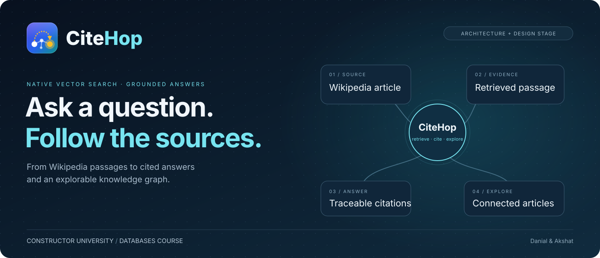
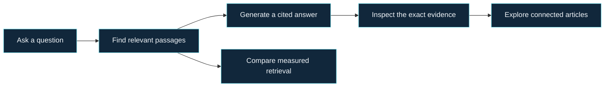
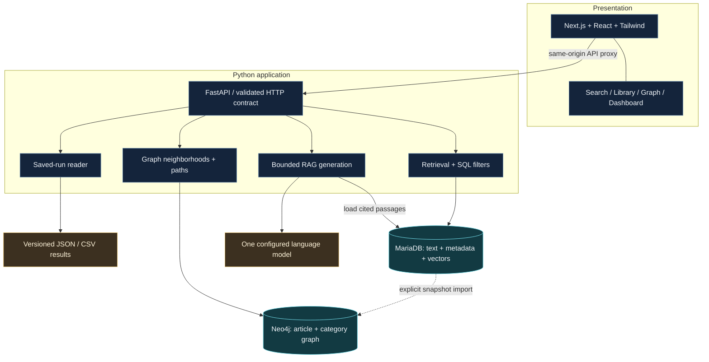
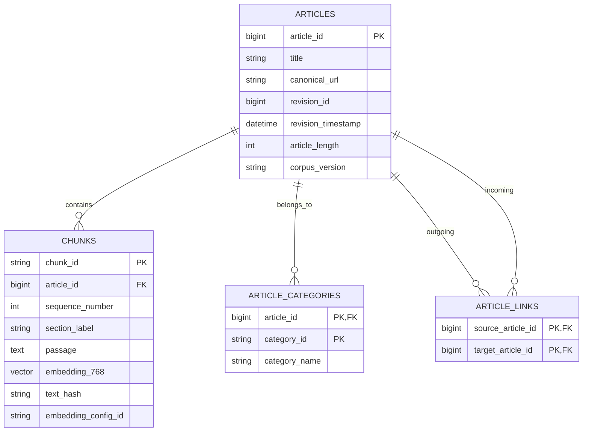
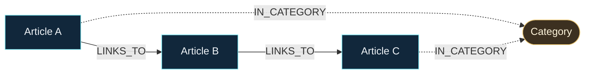
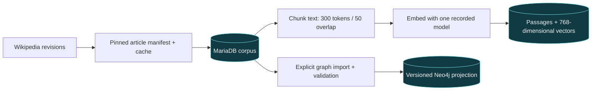
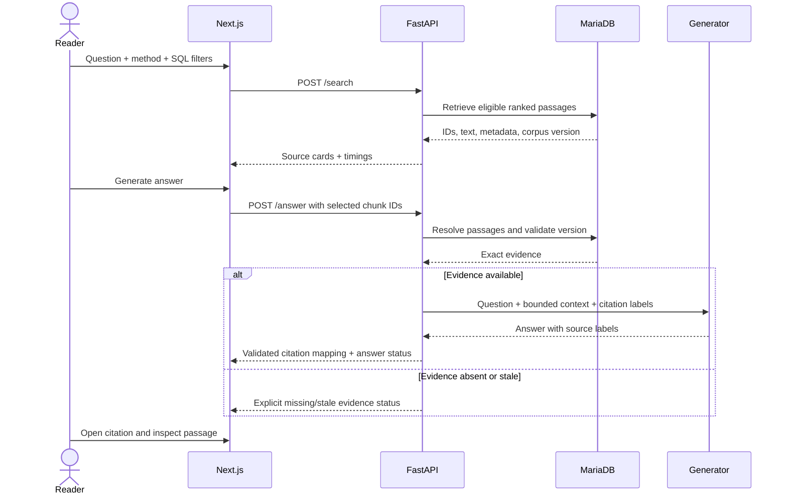
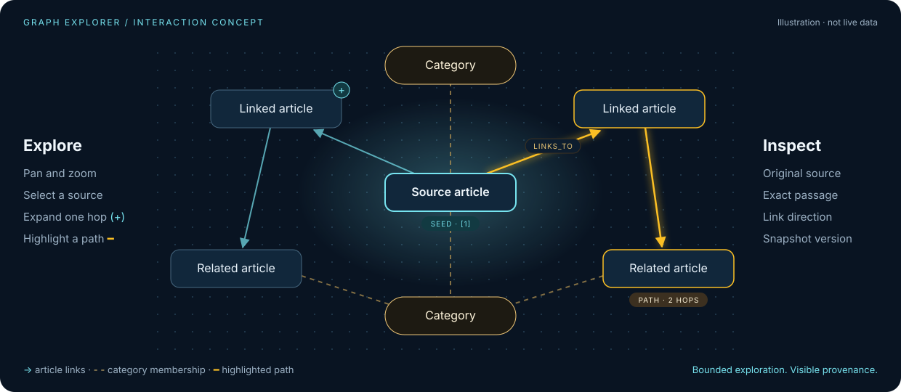
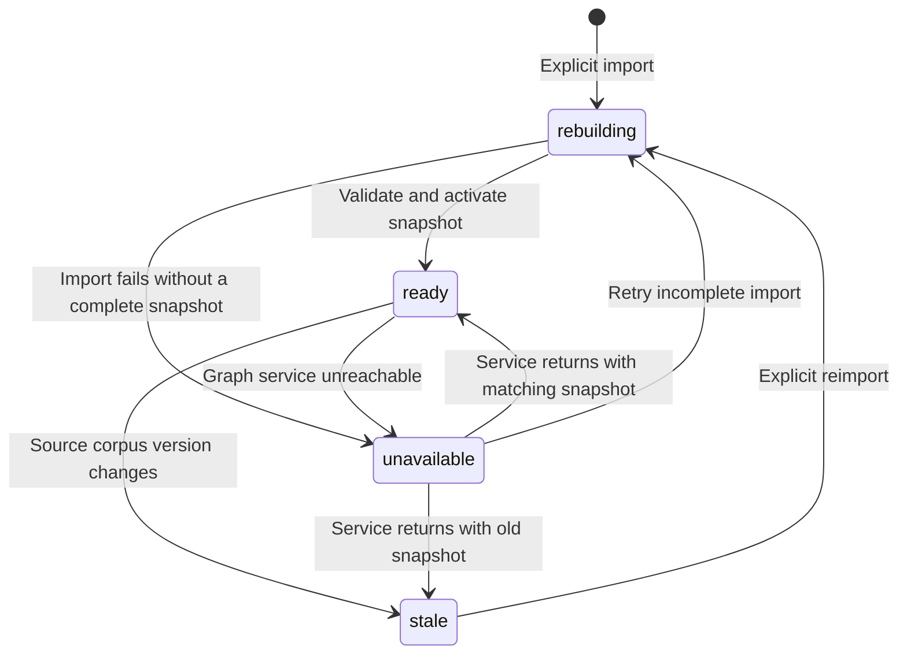

<p align="center">
  <picture>
    <source media="(prefers-color-scheme: dark)" srcset="assets/logo-dark.svg">
    
  </picture>
</p>

<p align="center"><strong>Ask a question. Follow the sources.</strong><br>Native vector search. Answers with citations. A knowledge graph you can explore.</p>

<p align="center">
  
  
  
</p>

<p align="center"><sub>A <strong>Databases course project at Constructor University</strong> · area 4, “<a href="https://mariadb.org/bachelor_hackathon_2026-09/#4-vector-search-and-rag-natively">Vector search and RAG, natively</a>” of the MariaDB student projects</sub></p>

<p align="center">
  <a href="#the-experience">Experience</a> ·
  <a href="#system-design">System design</a> ·
  <a href="#data-model">Data model</a> ·
  <a href="#the-knowledge-graph">Knowledge graph</a> ·
  <a href="#build-roadmap">Roadmap</a> ·
  <a href="#start-here">Start here</a>
</p>



> [!IMPORTANT]
> **C01, the local foundation, is in place:** a pinned Next.js frontend, a FastAPI app with a health route only, and MariaDB and Neo4j running under Docker Compose. Ingestion, search, generation, graph import, evaluation and every product screen are still to be built. The diagrams below describe the intended system; illustrations are concepts, not application screenshots.

## Why CiteHop

A useful answer should lead back to the material behind it. CiteHop is designed to retrieve relevant Wikipedia passages, generate a short answer with traceable citations, and let the reader explore the articles connected to those sources.

The database question is concrete: **how well does MariaDB's native vector search retrieve relevant sources when combined with ordinary relational filters?** We will compare it with keyword retrieval, measure recall and latency, and show what happens when the evidence is insufficient.

The graph adds a second way to explore: follow real article links and categories, inspect their provenance, and reveal bounded paths between sources. It does not turn a hyperlink into proof that two articles agree.

**Built by Danial and Akshat for the Databases course at Constructor University.**

## The experience

| ⌕ Search | ▤ Library | ◇ Graph | ▥ Dashboard |
|---|---|---|---|
| Ask a question; choose keyword or meaning search. | Browse the loaded article collection. | Explore sources as a connected neighborhood. | Understand the data and measured results. |
| Filter by category, article length, or incoming link source. | Inspect revisions, categories, and exact passages. | Select nodes, expand links, and highlight paths. | Compare recall, latency, and grounding checks. |
| Generate an answer explicitly; open every cited passage. | Open the original article or jump into the graph. | Keep source evidence beside the visualization. | Export a named run with its configuration. |



The visual direction is a dark research workspace: navy surfaces, cyan highlights, warm category accents, readable typography, and a responsive layout. [See the full UI specification →](docs/design/COURSE_UI.md)

## System design

**One frontend. One Python API. Two databases with distinct responsibilities.**



| Component | Selected technology | Responsibility |
|---|---|---|
| Web application | Next.js App Router, React, TypeScript | Routes, interaction state, source inspection |
| Visual system | Tailwind CSS | Shared tokens, responsive layouts, reusable components |
| Graph canvas | React Flow | Custom nodes, stable layouts, selection, expansion |
| Dashboard charts | Recharts | Small comparisons with accessible table alternatives |
| HTTP API | FastAPI, Pydantic | Validated requests, shared application logic, OpenAPI types |
| Corpus and retrieval | MariaDB, native `VECTOR(768)`, FULLTEXT | Canonical documents, embeddings, filters, joins |
| Relationship exploration | Neo4j Community | Derived graph, bounded neighborhoods and paths |
| Embeddings | `BAAI/bge-base-en-v1.5` | One consistent 768-dimensional representation |
| Evaluation | Python, saved JSON/CSV | Reproducible inputs, outputs, timings, review evidence |

React is used through Next.js. Python owns retrieval and generation. The frontend receives data through FastAPI and never connects directly to either database.

### Why both MariaDB and Neo4j?

MariaDB is the source of truth and the focus of the course demonstration. Text, metadata, and embeddings stay together; semantic retrieval applies SQL predicates and joins before the final result limit.

Neo4j is a **rebuildable graph projection** of the same article links and categories. It supports the visual explorer without replacing MariaDB's vector index. The tradeoff is an additional local service and an explicit import step. Search remains usable if the graph is unavailable; graph freshness is visible rather than assumed.

[Architecture decisions, local topology, API routes, and failure behavior →](docs/ARCHITECTURE.md)

## Data model

### Relational source of truth

The following is the **proposed logical schema**, not installed DDL. C03 will finalize column names, types, constraints, and indexes.



- **Articles** retain source URLs and revision identity so evidence can be traced to a snapshot.
- **Chunks** keep passages and their vectors together. FULLTEXT provides the keyword baseline; a native vector index supports cosine retrieval.
- **Categories and links** support ordinary SQL filters as well as graph import.
- **Evaluation results** live in named JSON/CSV artifacts with manifests; a separate metrics database is unnecessary for this scope.

### Derived property graph



These are relationship types, not sample corpus facts. Article IDs match MariaDB; category IDs are canonical. A Wikipedia link is recorded as `LINKS_TO`, never mislabeled as a scholarly citation or inferred similarity.

## From corpus to cited answer

### Prepare once; reuse the evidence



Chunk size and overlap are initial project choices, not measured optima. Ingestion records tokenizer/model revisions, input formatting, normalization, hashes, and actual token lengths; changed source text or configuration invalidates stale vectors. Details, commands, and measured counts: [docs/EMBEDDINGS.md](docs/EMBEDDINGS.md).

### Retrieve first; generate deliberately



Generation uses at most **five passages**, **1,800 context tokens**, and **300 output tokens** per explicit call. The backend loads passages by ID rather than trusting browser-supplied text. Unknown citation labels invalidate the answer; correctly formed citations still require a grounding check. Missing evidence and provider failures are visible states.

## The knowledge graph



The graph is a core product surface, designed around readable exploration:

| Explore | Understand | Stay oriented |
|---|---|---|
| Pan, zoom, fit view, minimap | Distinct article and category nodes | Stable positions during expansion |
| Expand a selected neighborhood | Directional edges and relation labels | Seed and search-result highlighting |
| Find a path between two articles | Source inspector with exact passages | Breadcrumbs and reset controls |
| Toggle categories and edge types | Snapshot version and provenance | Mobile detail panel and keyboard connection list |

**Exploration bounds:** one hop by default, two maximum; 50 nodes/100 edges by default, with a hard limit of 100/200. Article-to-article paths are limited to three links. The API enforces limits and timeouts; the canvas clearly marks truncated views. “No path within three links” does not mean two articles are unrelated.

### A graph that tells you how fresh it is



An implementation may retain an older complete snapshot during a rebuild. In every case, partial data must not appear current. Stale graph expansion/path queries are disabled; normal MariaDB retrieval continues. There is no claim of cross-database atomicity.

## Measure the result

The target is a small, honest experiment rather than an impressive-looking leaderboard.

| Planned scope | Target |
|---|---|
| Corpus | 100 English Wikipedia articles about machine learning |
| Smoke dataset | 10 articles |
| Ground truth | 30 manually checked questions: 10 dev / 20 test |
| Retrieval comparison | MariaDB FULLTEXT vs native vector retrieval |
| Index check | Indexed vs exact cosine retrieval on dev |
| Main metric | Article-level Recall@5, deduplicated across chunks |
| Timing | Median/p95 retrieval latency; embedding and generation reported separately |
| Grounding review | 10 saved answers checked for support, citations, and abstention |

**No benchmark results have been produced yet.** Unanswerable questions are tracked separately from answerable retrieval cases. Each run will preserve its corpus/configuration, split, raw ranks, timings, machine details, and review status. The dashboard will show “Not measured” and “Not reviewed” until evidence exists.

The experiment must report filtered-query behavior honestly, including when a query plan uses an exact scan. A small corpus is useful for teaching and validation; it does not establish large-scale performance.

## Build roadmap

C01 (local stack) is complete; C02–C14 are **pending**. Each has bounded scope, dependencies, relevant inputs, and acceptance checks.

| Stage | Tasks | Deliverable |
|---|---|---|
| 🧱 Foundation | C01–C03 | Local stack, pinned Wikipedia corpus, MariaDB schema |
| 🕸️ Knowledge | C04–C05 | Versioned Neo4j projection, reproducible embeddings |
| 🔎 Retrieval and RAG | C06–C08 | Filtered search, cited answers, measured evaluation |
| 🔌 Application contract | C09 | Validated FastAPI endpoints and typed client |
| 🎨 Product | C10–C13 | Library, polished search, visual graph, dashboard |
| 🎓 Submission | C14 | Reproducible tutorial, screenshots, findings, demo |

Optional after the core: reciprocal rank fusion, graph-assisted retrieval, and one controlled chunk-size comparison. Production hosting, authentication, background synchronization, and large parameter sweeps are outside this course scope.

**[Read all tasks →](docs/COURSE_TASKS.md) · [Copy an agent starting prompt →](docs/AGENT_PROMPTS.md)**

## Start here

```bash
git clone https://github.com/danialeyz/citehop.git
cd citehop
```

1. Read the [architecture](docs/ARCHITECTURE.md) and [visual specification](docs/design/COURSE_UI.md).
2. Set up the local stack below and confirm `make check` passes.
3. Continue with **C02** using its [copy-ready prompt](docs/AGENT_PROMPTS.md), following the dependencies in the [task plan](docs/COURSE_TASKS.md).

### Requirements and pinned stack

- Node **26.12.1**, npm **11.20.0**; Python **3.11** (tested **3.11.18**); uv **0.13.6**.
- Next.js **16.4.3**, React **19.3.1**, TypeScript **5.9.3**, Tailwind **4.3.3**.
- FastAPI **0.162.0**, Uvicorn **0.54.0**, MariaDB Python connector **1.1.14**, Neo4j driver **6.4.1**.
- Docker with Compose; MariaDB **11.8.9**, Neo4j Community **5.26.32**; native Connector/C (tested **3.4.11**).
- `frontend/package-lock.json` and `uv.lock` lock transitive dependencies. `requirements*.txt` are hashed pip exports; `pyproject.toml` is the Python dependency source. ML dependencies (torch 2.15.0, transformers 5.22.1) are the optional `ml` extra: `make venv-ml`; `requirements-ml.txt` is its export.

Versions were checked against official [Next installation](https://nextjs.org/docs/app/getting-started/installation) (Node >=20.9), [Tailwind Next integration](https://tailwindcss.com/docs/installation/framework-guides/nextjs), [FastAPI releases](https://fastapi.tiangolo.com/release-notes/), [MariaDB 11.8.9 release notes](https://mariadb.com/docs/release-notes/community-server/11.8/11.8.9), [Neo4j releases](https://neo4j.com/release-notes/) and [driver compatibility](https://neo4j.com/docs/python-manual/current/install/) (6.x supports Python >=3.10 and Neo4j 5.x). Exact package versions were confirmed through npm/PyPI. See [Node release policy](https://nodejs.org/en/about/previous-releases).

### Local setup

```sh
# macOS prerequisites (install Node separately using .node-version)
brew install python@3.11 mariadb-connector-c uv
export PATH="/opt/homebrew/opt/mariadb-connector-c/bin:$PATH"
# Debian/Ubuntu: install Python 3.11, build-essential, libmariadb-dev, and uv.
cp .env.example .env
cp frontend/.env.example frontend/.env.local
# Change local placeholder passwords before starting databases.
make venv frontend-install
make db-up
make check
make sql FILE=sql/smoke.sql
make api                    # terminal 1: http://127.0.0.1:8000/docs
make frontend               # terminal 2: http://127.0.0.1:3000
```

`GET /api/v1/health` works directly on port 8000 and through Next on port 3000. HTTP 200 / `status: ok` reports API liveness; `services.mariadb` and `services.neo4j` independently report `ready`/`unavailable`, without exception details or credentials. It performs read-only database probes. No feature routes exist yet. Blocking probes run in FastAPI's thread pool.

Next's `/api/*` rewrite forwards to FastAPI. `API_UPSTREAM` in `frontend/.env.local` is server-only and may also be used by future server-rendered API calls. Never put database/model secrets in frontend files or `NEXT_PUBLIC_*`. Only root `.env` contains database credentials; all environment files except examples are ignored. No model credentials are required for C01.

For port conflicts edit `DB_PORT`, `NEO4J_BOLT_PORT`, `NEO4J_HTTP_PORT` in root `.env`; update `NEO4J_URI` to match Bolt. Use `make api API_PORT=8001` and update frontend `API_UPSTREAM`; use `make frontend FRONTEND_PORT=3001`. Restart Next after changing upstream. Make's API port is a command-line override, not loaded from `.env`.

Compose binds ports to localhost. Use a distinct `COMPOSE_PROJECT_NAME` per checkout to isolate volumes. Named MariaDB data and Neo4j data/log volumes survive `make db-restart` and `make db-down` / `make db-up`. Never run `down -v` against data you need. Existing volumes are not migrated or reset; changing password variables does not change credentials already stored in a volume. Neo4j's initial username is `neo4j`. Docker runs databases only; API/frontend run on the host.

### Development and verification

```sh
make help
make test lint frontend-check
make check                         # live connections + cosine vector query
make sql FILE=sql/smoke.sql         # temporary VECTOR(3) table, no corpus data
make venv-ml embed-smoke embed-status  # C05 chunks + BGE vectors (docs/EMBEDDINGS.md)
make db-shell
.venv/bin/python scripts/check_persistence.py  # unique test row/node, restart, verify, cleanup
make db-restart                     # preserves named volumes
make db-down                       # stops only this Compose project
uv build                           # wheel/sdist include citehop.api
```

`make sql FILE=...` executes trusted local SQL with quoted semicolon handling. It is not a migration framework: DDL implicitly commits, and client `DELIMITER` scripts require the MariaDB CLI. C03 owns the corpus schema. `make locks` refreshes Python locks/exports after intentional dependency edits; commit lockfiles with those edits. Use `npm ci`, not an unpinned scaffold generator, for frontend installs.

<details>
<summary><strong>Project layout</strong> — entries marked “planned” are not implemented yet</summary>

```text
citehop/
├── frontend/            Next.js, React, Tailwind scaffold (screens planned)
├── citehop/             DB helpers, health probes, SQL runner
│   ├── api/             FastAPI app (health only; routes planned)
│   └── ...              acquire, corpus, chunking, embed, graph; planned: search, rag, evaluate
├── docker/              Compose: MariaDB 11.8.9 + Neo4j Community
├── sql/                 trusted SQL scripts (schema in C03)
├── scripts/             local checks; acquisition tools planned
├── eval/                planned: questions, labels, review status
├── tests/               unit and smoke checks
├── results/             placeholder: saved run evidence
├── assets/              logo variants and README illustrations
├── docs/
│   ├── ARCHITECTURE.md  service ownership and contracts
│   ├── COURSE_TASKS.md  14 core tasks + 3 optional tasks
│   ├── AGENT_PROMPTS.md one starting prompt per task
│   └── design/          current UI spec + historical visual references
└── app/                 retired; frontend work lives in frontend/
```

</details>

## Project guide

| Document | Use it for |
|---|---|
| [Architecture](docs/ARCHITECTURE.md) | Service boundaries, graph consistency, HTTP contract, limits |
| [Course task plan](docs/COURSE_TASKS.md) | Scope, dependencies, acceptance criteria, evaluation |
| [Agent prompts](docs/AGENT_PROMPTS.md) | Starting one bounded implementation task |
| [Current UI specification](docs/design/COURSE_UI.md) | Search, Library, Graph, Dashboard, visual acceptance |
| [Design system](docs/design/DESIGN_SYSTEM.md) | Existing visual tokens; current UI scope takes precedence |
| [Design instructions](docs/design/AGENT_INSTRUCTIONS.md) | Current guidance and explicitly superseded historical rules |

The older paper-search prototype contains fictional data. It remains a visual reference, not a product screenshot or a source of corpus facts.

## Course, sources, and credits

**Course:** Databases · **University:** Constructor University · **Team:** Danial and Akshat.

CiteHop follows the [MariaDB student project brief, area 4](https://mariadb.org/bachelor_hackathon_2026-09/#4-vector-search-and-rag-natively). The intended submission teaches native vector retrieval through a working, reproducible application with measured findings. Neo4j is an additional exploration layer; the MariaDB demonstration remains self-contained.

Planned source material comes from Wikipedia with recorded page URLs, revisions, and attribution. The embedding model is [BAAI/bge-base-en-v1.5](https://huggingface.co/BAAI/bge-base-en-v1.5). Dataset/model terms and attribution will be recorded during acquisition; the repository does not currently bundle the corpus, model weights, or benchmark outputs.

<p align="center">
  <br>
  <strong>Every answer has a source. Every hop has a boundary.</strong><br>
  <sub>A Databases course project at Constructor University.</sub>
</p>
