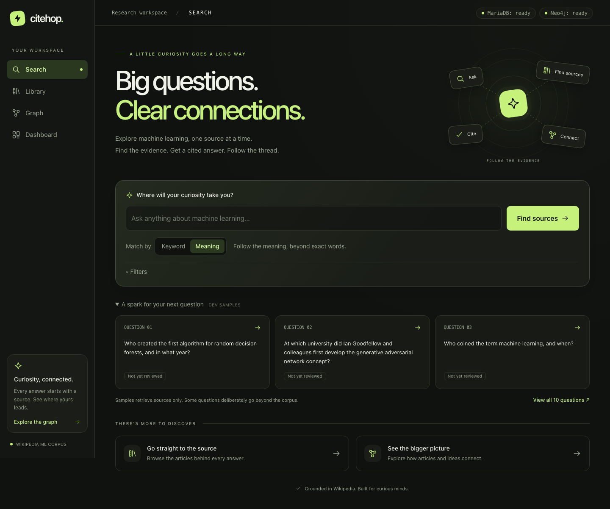
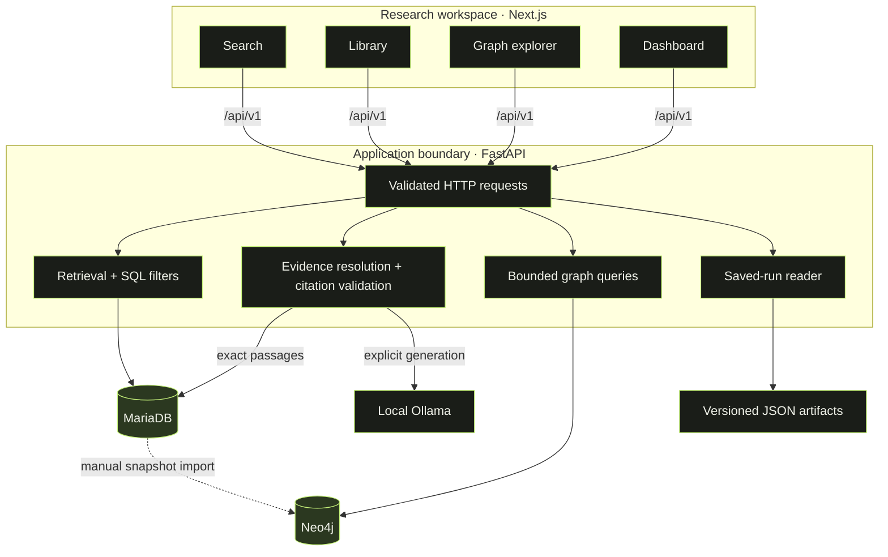
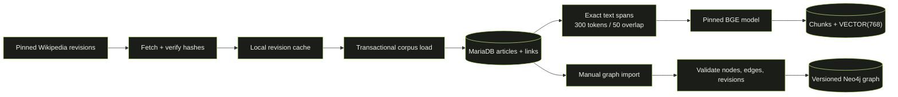
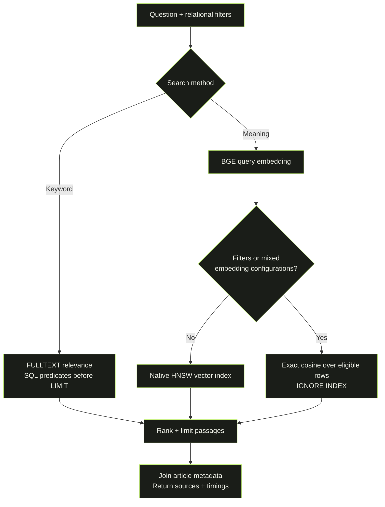
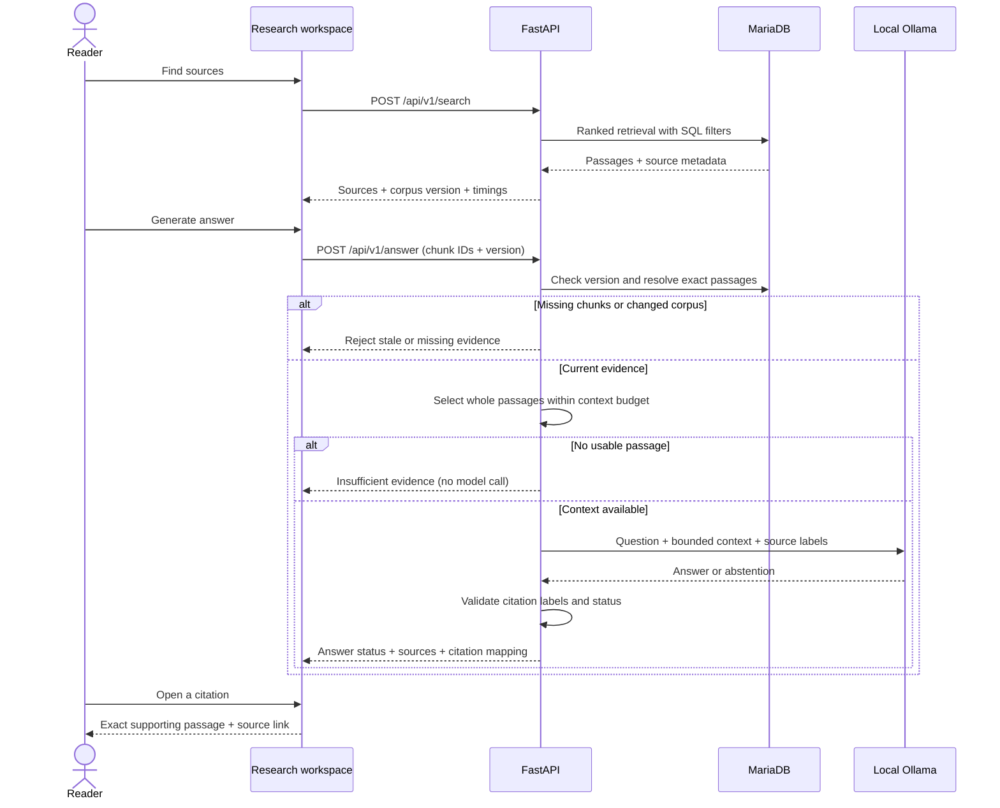
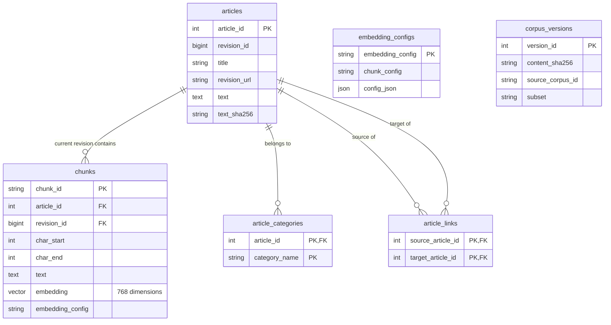
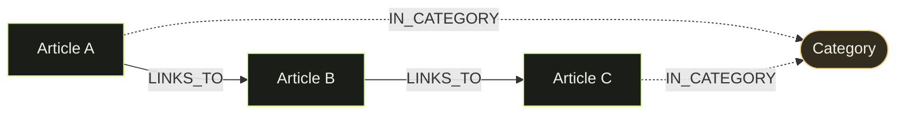
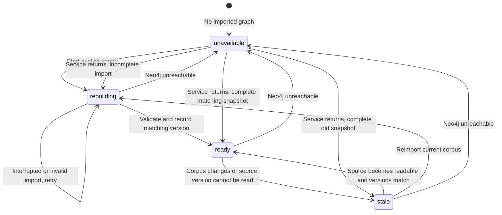
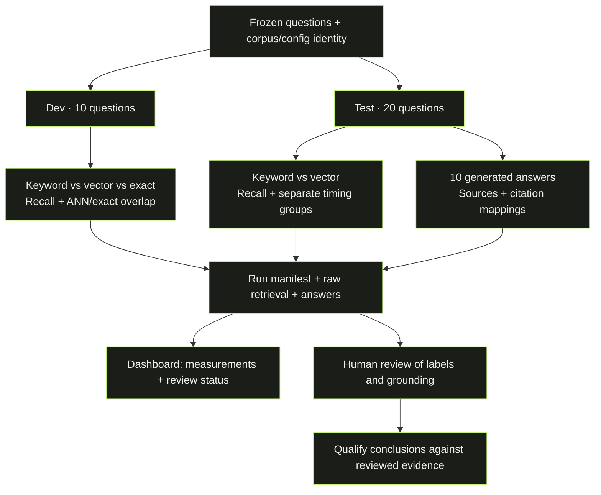

<h1 align="center">citehop.</h1>
<p align="center"><strong>Big questions. Clear connections.</strong><br>Search the evidence. Generate a cited answer. Follow the thread.</p>

<p align="center">
  
  
  
</p>

<p align="center">
  <a href="#the-experience">Explore</a> ·
  <a href="#start-here">Run locally</a> ·
  <a href="#system-design">Architecture</a> ·
  <a href="#measure-the-result">Evaluation</a> ·
  <a href="#project-guide">Documentation</a>
</p>



<p align="center"><sub>Actual application screenshot · <a href="assets/readme/workspace-mobile.png">See the mobile layout</a> · Built by Danial and Akshat for the Databases course at Constructor University.</sub></p>

## Why CiteHop

An answer is more useful when you can inspect the evidence behind it. CiteHop is a local research app over a pinned collection of **100 English Wikipedia articles about machine learning**. It retrieves passages with MariaDB, generates answers with source labels through a local language model, and lets you explore article relationships in Neo4j.

The central database question is concrete: **how does MariaDB’s native vector retrieval compare with keyword search when ordinary relational filters are involved?** The repository includes the implementation, a reproducible evaluation harness, and saved provisional results.

Search, Library, Graph, and Dashboard are implemented. Question labels and answer grounding still need human review before the evaluation supports final claims. This is a course project for local use; authentication and production hosting are outside its scope.

## The experience

| Surface | What you can do |
|---|---|
| **Search** · `/` | Choose Keyword or Meaning retrieval, filter by category, article length, or linking article, then explicitly generate an answer and inspect its cited passages. |
| **Library** · `/library` | Browse articles, inspect source revisions and stored passages, and open their graph neighborhoods. |
| **Graph** · `/graph` | Select and expand articles, inspect categories and directional links, and find bounded paths between sources. |
| **Dashboard** · `/dashboard` | Inspect corpus and graph status, compare saved retrieval runs, review timing and grounding status, and export results. |

The charcoal-and-lime workspace adapts to desktop and mobile, with keyboard navigation, visible focus states, collapsible filters, and expandable sample questions from the dev split. Loading, empty, stale-data, and service-failure states are part of the interface.

**Try the flow:** ask a question → find sources → generate an answer → inspect a citation → explore connections.

- Retrieval and generation are separate actions. Clicking a sample question only retrieves sources.
- Answers use at most five passages, an **estimated** 1,800-token context budget, and a 300-token output cap. Citation labels are validated; a valid label alone does not establish grounding.
- The graph follows Wikipedia article links and categories. A link is not evidence that two articles agree.
- Graph exploration defaults to one hop, 50 nodes, and 100 edges; limits are two hops, 100 nodes, and 200 edges. Article paths use at most three links.

## Start here

### 1. Install prerequisites

Use the versions pinned by this repository:

| Requirement | Version / purpose |
|---|---|
| Node.js / npm | **26.12.1 / 11.20.0**; see [`.node-version`](.node-version) and [`frontend/package.json`](frontend/package.json) |
| Python | **3.11**; see [`.python-version`](.python-version) |
| uv | Python environment and locked dependencies |
| Docker with Compose | MariaDB **11.8.9** and Neo4j Community **5.26.32** |
| MariaDB Connector/C | Native dependency for the Python connector |
| Ollama | Optional for cited answer generation; retrieval works without it |

On macOS, install the native prerequisites with Homebrew, and install the pinned Node version separately:

```sh
brew install python@3.11 mariadb-connector-c uv
# Apple Silicon; use your Homebrew prefix on other systems.
export PATH="/opt/homebrew/opt/mariadb-connector-c/bin:$PATH"
```

On Linux, install Python 3.11, a C build toolchain, MariaDB development headers, and uv through your system’s package setup.

### 2. Set up the local stack

```sh
git clone https://github.com/danialeyz/citehop.git
cd citehop
cp .env.example .env
cp frontend/.env.example frontend/.env.local
```

Edit root `.env` to choose local database passwords and a `COMPOSE_PROJECT_NAME` unique to your checkout, then run:

```sh
make venv-ml frontend-install
make db-up
make check
make sql FILE=sql/corpus_schema.sql
```

`make venv-ml` installs the locked runtime, development tools, and ML dependencies needed for embeddings and Meaning search. `make venv` installs without the ML extra and removes it from an existing environment. Dependency versions live in [`pyproject.toml`](pyproject.toml), `uv.lock`, and `frontend/package-lock.json`.

### 3. Load and prepare the corpus

```sh
# Fetch the revisions pinned in eval/corpus.json.
.venv/bin/python -m citehop.acquire fetch --subset full
.venv/bin/python -m citehop.corpus --snapshot data/wikipedia/full.json

# Create passage embeddings, then build the graph projection.
make embed
make graph-import
make embed-status graph-status
```

The first embedding run downloads the pinned `BAAI/bge-base-en-v1.5` model into the Hugging Face cache. Acquisition downloads missing Wikipedia revisions and checks their hashes; it does not silently replace pinned content. If a revision’s rendered content has changed, see the [acquisition and cache instructions](eval/README.md).

For a smaller first run, fetch `--subset smoke`, load `data/wikipedia/smoke.json`, and use `make embed-smoke` before importing the graph. **Loading a snapshot reconciles the whole corpus:** loading smoke after full removes the other 90 articles. Keep the full dataset for the saved evaluation’s question set.

### 4. Start the app

In two terminals, from the repository root:

```sh
# Terminal 1
make api

# Terminal 2
make frontend
```

| Local service | Address |
|---|---|
| **CiteHop** | **http://127.0.0.1:3000** |
| API documentation | http://127.0.0.1:8000/docs |
| API health | http://127.0.0.1:8000/api/v1/health |
| Neo4j Browser | http://127.0.0.1:7474 |

Try **“Who coined the term machine learning?”**, choose a retrieval method, and select **Find sources**. The Library and Graph should now reflect your loaded snapshot.

### 5. Enable cited answers (optional)

Start Ollama and pull the model configured by `CITEHOP_GENERATOR_MODEL` in root `.env`. The example configuration uses:

```sh
ollama serve  # if the Ollama app is not already running
# In another terminal:
ollama pull hf.co/unsloth/Qwen3.6-35B-A3B-GGUF:UD-IQ3_XXS
```

This model is about **14 GB on disk** and needs sufficient local resources. Set `OLLAMA_HOST` and `CITEHOP_GENERATOR_MODEL` in root `.env`, then restart the API if you changed them. No model API key is required. Select **Generate answer** after retrieving sources; source passages remain available if generation fails. See [generation limits and validation](docs/RAG.md).

### Local configuration and troubleshooting

| Situation | What to check |
|---|---|
| UI reports API unreachable | Start `make api`; check `API_UPSTREAM` in `frontend/.env.local`, then restart Next.js. |
| API health returns 200 but a database is unavailable | Health reports API liveness separately from `services.mariadb` and `services.neo4j`; run `make db-up` and `make check`. |
| Library is empty | Apply the schema and load a corpus snapshot in steps 2–3. |
| Meaning search lacks embeddings | Run `make venv-ml`, `make embed`, and `make embed-status`; restart the API after installing dependencies. |
| Graph is stale or missing | Run `make graph-import` after loading a changed corpus, then `make graph-status`. |
| Port already in use | Override API/frontend ports as below; database ports are configured in root `.env`. |

```sh
make api API_PORT=8001
# Set API_UPSTREAM=http://127.0.0.1:8001 in frontend/.env.local.
make frontend FRONTEND_PORT=3001
```

Next.js proxies `/api/*` to FastAPI and uses the same upstream for server-side requests. Database and model settings belong in root `.env`, never `NEXT_PUBLIC_*`. For database port changes, update `DB_PORT`, `NEO4J_BOLT_PORT`, and `NEO4J_HTTP_PORT`; `NEO4J_URI` must match the Bolt port.

Docker runs the databases; the API and frontend run on the host. `make db-down` preserves named volumes. Changing password variables does not change credentials already stored in an existing volume, and Compose `down -v` deletes its persisted data.

## System design

**One frontend. One Python API. Two databases with distinct responsibilities.**



| Layer | Implementation |
|---|---|
| Interface | Next.js App Router, React, TypeScript, Tailwind CSS |
| Graph and charts | React Flow and Recharts |
| API | FastAPI and Pydantic; generated OpenAPI types for the frontend |
| Retrieval | MariaDB `FULLTEXT` and native cosine search over `VECTOR(768)` |
| Embeddings | Pinned `BAAI/bge-base-en-v1.5`, 300-token windows with 50-token overlap |
| Graph | Neo4j Community, derived from versioned article links and categories |
| Generation | Local Ollama, bounded context, explicit source labels |
| Evaluation | Frozen dev/test questions, raw ranks, timings, manifests, and review fields |

MariaDB is the source of truth. Neo4j is a rebuildable projection, so graph outages do not prevent MariaDB retrieval. Version checks keep stale graph data from being presented as current.

**Filtered vector queries intentionally use exact cosine scans.** On the pinned MariaDB version, applying filters to indexed candidates can miss eligible passages. CiteHop applies SQL filters before the result limit; unfiltered vector retrieval can use the native HNSW index. See the [query plans and retrieval rationale](docs/RETRIEVAL.md).

### From pinned articles to searchable evidence

Preparation happens explicitly. Embedding runs resume completed work; graph import validates a snapshot before marking it ready.



### How a query chooses its retrieval path

Keyword search uses FULLTEXT. Meaning search embeds the query once, then selects an indexed or exact path according to the eligible corpus. All paths return ranked passages with source metadata.



### From retrieved passages to a cited answer

The browser sends chunk IDs and the corpus version. The API resolves the actual evidence; it does not trust passage text supplied by the browser.



### Data model

The installed schema is [`sql/corpus_schema.sql`](sql/corpus_schema.sql):

| Table | Stores |
|---|---|
| `articles` | Wikipedia page and revision identity, source text, URLs, hashes, and attribution |
| `chunks` | Exact passage spans, deterministic IDs, configuration hashes, and 768-dimensional vectors |
| `article_categories` | Category membership by exact name |
| `article_links` | Directed links between corpus articles |
| `embedding_configs` | Reproducible chunking and embedding settings |
| `corpus_versions` | Loaded snapshot identity and counts |

The relationships below use actual schema names; fields are abbreviated. `embedding_config` is an application-level association, not a declared SQL foreign key, and `corpus_versions` tracks snapshots rather than individual article rows.



Neo4j projects article nodes, category nodes, `LINKS_TO`, and `IN_CATEGORY` relationships. It does not infer agreement or scholarly citations. See the [data model](docs/DATA_MODEL.md) and [graph documentation](docs/GRAPH.md) for constraints and import behavior.

### Two kinds of graph relationship

This is a structural example, not a claim about particular corpus articles. Path finding follows article links only; shared categories do not create path shortcuts.



### Graph freshness is a state, not an assumption

Imports rebuild in place. An interrupted import stays `rebuilding`; neighborhood and path queries are served only in `ready`. Source-version checks may be cached for up to five seconds.



## Measure the result

The repository includes a [saved provisional run](results/runs/20261031T162301Z-dev-test-15b1f5a1/manifest.json) over **100 articles and 1,776 chunks**, using **10 dev and 20 test questions**. It compares keyword and vector retrieval, checks indexed versus exact retrieval on dev, and saves 10 generated answers for grounding review.

**These are evaluation-harness results, not final quality claims.** The saved run marks all 30 question labels unreviewed and sets `final_claims_allowed: false`; none of its 10 answers has completed grounding review. The Dashboard exposes those review states alongside the measurements.

- Recall@5 is measured at article level after deduplicating chunk hits.
- Answerable and unanswerable cases are reported separately.
- Filtered exact scans and unfiltered indexed retrieval have separate timing summaries.
- Query embedding, retrieval, and generation timing are kept separate.
- Run manifests preserve corpus/configuration identity and measurement conditions.



Run `make eval` against a prepared full corpus, with ML dependencies and Ollama available. This performs generation calls and writes a new run under `results/runs/`. Read the [evaluation protocol and provisional findings](docs/EVALUATION.md) and [human review checklist](eval/README.md) before interpreting or publishing results.

## Development and verification

```sh
make help                         # available targets
make test lint                    # backend unit checks; no databases required
make frontend-check               # lint, types, unit tests, production build
make check                        # live database connectivity and vector check
make api-types                    # regenerate API contract and frontend types
make test-model                   # real tokenizer/model tests; downloads weights
make rag-validate                 # live search and generation validation
```

Database integration tests need disposable test instances; see the relevant subsystem docs before running them. `make test-graph` uses `CITEHOP_TEST_NEO4J_URI` and `CITEHOP_TEST_NEO4J_PASSWORD` and clears the test graph’s CiteHop namespace.

Use `npm ci` and the locked uv environment for installs. `make locks` intentionally refreshes Python locks and exports after dependency edits; commit lockfiles with those changes.

<details>
<summary><strong>Repository layout</strong></summary>

```text
frontend/         Search, Library, Graph, Dashboard; typed API client
citehop/          Acquisition, corpus loading, embeddings, retrieval, RAG, evaluation
  api/            FastAPI routes and request/response schemas
  graph/          Neo4j import, status, neighborhoods, and paths
docker/           Local MariaDB and Neo4j services
sql/              Corpus schema, smoke queries, retrieval examples
eval/             Pinned article manifest and frozen draft question set
results/          Saved evaluation runs and validation evidence
scripts/          API smoke checks, persistence checks, validation helpers
tests/            Backend unit and integration tests
assets/readme/    Application screenshots and historical concept illustrations
docs/             Architecture, subsystem guides, course plan, design references
```

</details>

## Project guide

| Document | Use it for |
|---|---|
| [Architecture](docs/ARCHITECTURE.md) | Service ownership, API boundaries, and failure behavior |
| [Corpus and questions](eval/README.md) | Pinned revisions, cache recovery, attribution, label review |
| [Data model](docs/DATA_MODEL.md) | Schema, constraints, loading, and versioning |
| [Embeddings](docs/EMBEDDINGS.md) | Model configuration, chunking, resumable embedding runs |
| [Retrieval](docs/RETRIEVAL.md) | SQL filtering, index behavior, query plans |
| [Cited answers](docs/RAG.md) | Generator configuration, limits, citation validation |
| [Graph](docs/GRAPH.md) / [Graph explorer](docs/GRAPH_EXPLORER.md) | Import and freshness, visual exploration and bounds |
| [API](docs/API.md) | Endpoint contract, errors, and typed client |
| [Evaluation](docs/EVALUATION.md) | Measurement protocol, saved runs, provisional findings |
| [UI specification](docs/design/COURSE_UI.md) | Product flows and acceptance criteria |
| [Course plan](docs/COURSE_TASKS.md) / [Agent prompts](docs/AGENT_PROMPTS.md) | Task scope, dependencies, and implementation guidance |

The live theme is defined in [`frontend/app/globals.css`](frontend/app/globals.css). Older design mockups and concept illustrations are historical references, not screenshots or sources of corpus facts.

## Course, sources, and credits

**Databases · Constructor University · Danial and Akshat.** CiteHop follows area 4, “Vector search and RAG, natively,” of the [MariaDB student project brief](https://mariadb.org/bachelor_hackathon_2026-09/#4-vector-search-and-rag-natively).

Wikipedia text is attributed to its contributors, with pinned revision, history, and license URLs recorded during acquisition; see [provenance and attribution](eval/README.md#provenance-and-attribution). The corpus cache and model weights are downloaded separately. Saved evaluation artifacts include source passages and review metadata. The embedding model is `BAAI/bge-base-en-v1.5`; model configuration and revision are documented in the [embedding guide](docs/EMBEDDINGS.md).

<p align="center"><strong>Every answer has a source. Every hop has a boundary.</strong></p>
