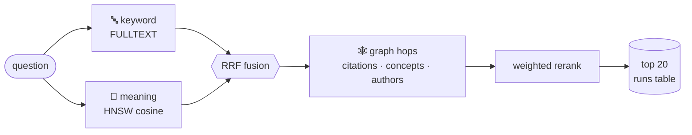

<p align="center">
  <picture>
    <source media="(prefers-color-scheme: dark)" srcset="assets/logo-dark.svg">
    
  </picture>
</p>

<p align="center">
  <b>Search 64,183 ML and NLP papers by words, by meaning, and by the citations between them.</b><br>
  One database. No sidecar vector store. No sync jobs.
</p>

<p align="center">
  
  
  
  
  
  
</p>

<p align="center">
  <a href="#quick-start">Quick start</a> ·
  <a href="#how-search-works">How search works</a> ·
  <a href="#the-question">The question</a> ·
  <a href="#status">Status</a> ·
  <a href="#docs">Docs</a>
</p>

---

## CiteHop

CiteHop is a scientific paper search engine built entirely inside MariaDB.
It finds papers three ways, then asks a simple question: **do citation links find correct papers that words and meaning miss?**

| Signal | What it matches | Built with |
|---|---|---|
| 🔤 Keyword | the exact words in title and abstract | `FULLTEXT` index |
| 🧠 Meaning | what the question is about, even with different words | `VECTOR(768)` + HNSW index |
| 🕸️ Graph | papers linked by citations, shared authors and shared concepts | recursive CTEs |

A university Databases course project by **Danial** and **Akshat**.

---

## The question

Keyword search misses synonyms. Vector search misses the paper that uses odd wording but is cited by every good answer.
A citation graph might close that gap. Or it might drag in noise.

We test it with a **12-configuration ablation (A to L)** on the 597 LitSearch questions, graded in SQL against the answer key.

**The bar to beat** (LitSearch paper, Recall@5 on specific questions):

| System | Recall@5 |
|---|---:|
| Google Scholar ¹ | 20.5 |
| BM25 | 50.0 |
| E5-large-v2 | 56.2 |
| GritLM-7B | 74.8 |
| **CiteHop** | *coming in Week 4* |

¹ 80 inline-citation questions only.

> [!NOTE]
> The literature says graph expansion helps weak retrievers and hurts when unweighted.
> In LitSearch, one-hop expansion moved GritLM from 73.2 **down** to 70.3.
> That is why CiteHop weights and damps every hop.

---

## How search works



1. **Keyword.** A MariaDB `FULLTEXT` index over title and abstract. We call it "MariaDB full-text", not BM25, because it is not BM25.
2. **Meaning.** Each paper is a 768-number vector from `BAAI/bge-base-en-v1.5`. An HNSW index with cosine distance finds the nearest ones.
3. **Fusion.** Reciprocal Rank Fusion merges the two ranked lists. A paper ranked high by both wins.
4. **Graph hops.** From the fused seeds, recursive CTEs walk citations, shared authors and LLM-extracted concepts. Every walk has a depth limit.
5. **Rerank.** A weighted score combines the signals. Every result records how it was found (`kw`, `vec`, `cite`, `concept`, `author`), so we can count papers found *only* through the graph.

### A taste of the SQL

Meaning search. This exact shape is the only one that uses the vector index:

```sql
SELECT corpusid
FROM emb_bge_base
ORDER BY VEC_DISTANCE_COSINE(emb, ?)
LIMIT 100;
```

One hop along citations, with the depth limit in the recursive part (a sketch; `seeds` holds the fused results):

```sql
WITH RECURSIVE hop (corpusid, depth) AS (
  SELECT corpusid, CAST(0 AS SIGNED) FROM seeds
  UNION
  SELECT c.cited_id, h.depth + 1
  FROM hop h
  JOIN citations c ON c.citing_id = h.corpusid
  WHERE h.depth < 1
)
SELECT corpusid, MIN(depth) AS depth
FROM hop
GROUP BY corpusid;
```

### Why one database

- Vectors, text and graph join in **one query**.
- No second store to keep in sync.
- Grading is SQL too: `runs` joins `qrels`, and Recall@k is a `GROUP BY`.

---

## Status

| Week | Focus | Cards | State |
|---|---|---|---|
| 0 | Repo, Docker, schema, CI, docs | #2, #5, #6, #8, #9 | 🟡 in progress |
| 1 | Load papers, citations, questions, enrichment | #10 to #12.7 | ⬜ |
| 2 | Embeddings, concept extraction, vector indexes | #13 to #15.5 | ⬜ |
| 3 | Keyword, vector, fused and graph search | #16 to #24 | ⬜ |
| 4 | Ablation A to L, latency, demo app | #25 to #28.5 | ⬜ |

The task board lives in Notion.

---

## Requirements

| Tool | Version | Why |
|---|---|---|
| Docker | Desktop or Colima | runs MariaDB |
| Python | 3.11 | the `citehop` package |
| Node.js | 22+ | the Next.js frontend in `web/` |
| MariaDB Connector/C | any recent | builds the `mariadb` Python driver |
| git | any | |

Install Connector/C:

```bash
# macOS (keg-only, so put it on PATH before make venv)
brew install mariadb-connector-c
export PATH="/opt/homebrew/opt/mariadb-connector-c/bin:$PATH"

# Ubuntu / Debian / WSL2
sudo apt-get install -y libmariadb-dev
```

---

## Quick start

```bash
cp .env.example .env        # local settings, never committed
make venv                   # .venv with core + dev deps
source .venv/bin/activate
make db-up                  # MariaDB 11.8.9, waits until healthy
make check                  # prints the version and config, then OK
make schema kg-schema       # 12 tables + the kg_links view, safe to rerun
```

You should see:

```text
server: 11.8.9-MariaDB-...
mhnsw_max_cache_size = 1073741824
innodb_ft_min_token_size = 2
OK: connected to MariaDB 11.8.9-MariaDB-...
```

### All commands

| Command | What it does |
|---|---|
| `make help` | list targets |
| `make venv` | create `.venv` and install core + dev deps |
| `make db-up` | start MariaDB 11.8.9 and wait until healthy |
| `make db-down` | stop MariaDB, keep the data |
| `make db-reset` | delete all data and start fresh (asks first) |
| `make db-shell` | open a `mariadb` prompt |
| `make check` | verify connection and version |
| `make schema` | create the 6 core tables |
| `make kg-schema` | create the knowledge graph tables and view |
| `make test` | unit tests, no DB |
| `make test-db` | integration tests, needs `make db-up` |
| `make lint` | ruff |
| `make inspect` | download LitSearch and print its fields |

---

## Project layout

```text
citehop/
├── citehop/        Python package: db, schema runner, embed, loaders, search, evaluate
├── sql/            schema.sql (6 core tables), kg_schema.sql (KG tables + kg_links view)
├── docker/         docker-compose.yml and my.cnf for MariaDB 11.8.9
├── scripts/        one-off tools, like inspect_litsearch.py
├── tests/          unit tests and DB tests (marker: db)
├── notebooks/      Colab embedding notebook
├── web/            Next.js + TypeScript + Tailwind frontend
├── data/           local data, gitignored except NOTES.md
├── results/        plots and run outputs
├── docs/           architecture, data model, decisions, experiments, results, traps
├── design/         approved UI handoff 1.0: prototype, specs, contracts, captures
└── assets/         logo (mark from design/assets/logo.svg)
```

---

## Docs

Docs marked *(Phase E)* are written in bootstrap Phase E. Links go live then.

| Doc | Read it when |
|---|---|
| ARCHITECTURE *(Phase E)* | you want the big picture: build once vs every search |
| DATA_MODEL *(Phase E)* | you touch a table or write SQL |
| TRAPS *(Phase E)* | before any SQL work. Seriously. |
| DECISIONS *(Phase E)* | you wonder "why did we do it this way?" |
| EXPERIMENTS *(Phase E)* | you run or read the A to L ablation |
| RESULTS *(Phase E)* | you want the numbers and the command behind each |
| GLOSSARY *(Phase E)* | a word like HNSW, RRF or nDCG trips you up |
| CONTRIBUTING *(Phase E)* | you open a branch or a PR |
| [design/](design/README.md) | you build the demo app or the graph explorer |
| CLAUDE.md *(Phase E)* | you work with Claude Code |

---

## Credits and licences

| Resource | Licence | Note |
|---|---|---|
| [LitSearch](https://huggingface.co/datasets/princeton-nlp/LitSearch) | MIT | 64,183 papers, 597 questions |
| [bge-base-en-v1.5](https://huggingface.co/BAAI/bge-base-en-v1.5) | MIT | embedding model |
| [Semantic Scholar](https://www.semanticscholar.org/) data | attribution required | paper ids, authors, venues |
| SciFact | CC BY-NC | used for a sanity check, not redistributed |

<p align="center"><sub>Built by Danial and Akshat. Every hop has a depth limit.</sub></p>
