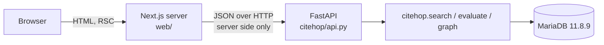

# Frontend architecture: Next.js

## Decision

Date: 2026-09-29. Decided by: Danial (owner of the demo).

The frontend is **React + TypeScript + Next.js + Tailwind CSS**. This replaces the planned Streamlit app (`app/streamlit_app.py`, card #28). It is the "separate architecture decision" that docs/05 required before building a SPA.

Everything else stays: MariaDB 11.8.9 is the only store, and retrieval, graph traversal and evaluation stay in the Python package `citehop/`. Where an older doc in this folder says Streamlit, this document wins.

Record it as a decision in `docs/DECISIONS.md` when that file is written (bootstrap Phase E).

## Consequence: a Python API is required

The browser cannot run `citehop.search` or embed a query with bge-base-en-v1.5. Next.js therefore talks to a small Python HTTP API that wraps the existing modules.

| Layer | Tech | Location | Owns |
| --- | --- | --- | --- |
| Frontend | Next.js (App Router), React, TypeScript strict, Tailwind CSS v4 | `web/` | Rendering, routing, UI state |
| API | FastAPI (confirmed 2026-09-29) | `citehop/api.py` | HTTP boundary, view-model adapters, validation, error mapping |
| Domain | Python | `citehop/search.py`, `evaluate.py`, graph module | Retrieval, fusion, graph walks, metrics |
| Data | MariaDB 11.8.9 | Docker | Everything persistent |



Rules:
- Only the API connects to MariaDB. Next.js never holds DB credentials and never imports a MariaDB driver.
- Next.js calls the API from server code (Server Components, Route Handlers, Server Actions). The API URL is a server-only env var `CITEHOP_API_URL`. Nothing secret gets a `NEXT_PUBLIC_` prefix.
- The API returns the view models in docs/04 and `contracts/`. It does not return raw rows or vector bytes.
- FastAPI was confirmed by the owner on 2026-09-29. Add `fastapi` and `uvicorn` to requirements.txt in the API card.

## Proposed API surface

| Method and path | Returns | Maps to |
| --- | --- | --- |
| `GET /health` | DB reachable, server version | `SELECT VERSION()` |
| `GET /stats` | paper and question counts, or null before load | `COUNT(*)` on papers, queries |
| `POST /search` `{query, method, parameters?, request_id}` | `SearchView` | `search.keyword / vector / fused / citehop` |
| `GET /papers/{corpusid}` | paper, authors, venue, concept evidence | papers, paper_authors, venues, paper_concepts |
| `GET /graph?seed=paper:<id>&depth=1\|2` | nodes, edges, seed, depth_limit, truncated | bounded query over kg_links or typed tables |
| `GET /experiments?split=dev\|test` | A to L rows, metrics, run metadata, or pending | runs, qrels, queries |

- `depth` is clamped on the server. A client value above the limit is rejected, not trusted.
- `split` is required on every experiment call. Test is read-only at the API, not only in the UI.
- Errors use the docs/04 shape: stable code, safe message, retryable, partial. No SQL, stack traces or connection strings.

## Frontend layout

```text
web/
├── package.json            # pinned versions + lockfile committed
├── tsconfig.json           # "strict": true
├── next.config.ts
├── src/
│   ├── app/                # App Router
│   │   ├── layout.tsx      # AppShell: sidebar, header, skip link
│   │   ├── page.tsx        # Search landing            (#search)
│   │   ├── search/page.tsx # Results  ?q=&method=      (#results, loading/empty/error)
│   │   ├── papers/[corpusid]/page.tsx   # Paper detail (#paper-n)
│   │   ├── graph/page.tsx  # Graph explorer ?seed=&depth= (#graph, #missing)
│   │   ├── experiments/page.tsx         # ?split=dev|test
│   │   ├── settings/page.tsx
│   │   └── globals.css     # Tailwind + @theme tokens
│   ├── components/         # one file per docs/08 component
│   ├── lib/api.ts          # typed server-side client for the API
│   └── lib/types.ts        # generated from contracts/search-view.schema.json
└── tests/                  # Vitest + Testing Library; Playwright e2e
```

Route mapping from the prototype:

| Prototype hash | Next.js route | State in URL |
| --- | --- | --- |
| `#search` | `/` | none |
| `#results` | `/search` | `q`, `method` |
| `#paper-1` | `/papers/[corpusid]` | corpusid as a string |
| `#graph` | `/graph` | `seed`, `depth` |
| `#experiments` | `/experiments` | `split` |
| `#settings` | `/settings` | none (settings live in client state) |
| `#loading` | `search/loading.tsx` | |
| `#empty` | empty branch of `/search` | |
| `#error` | `search/error.tsx` | |
| `#missing` | empty branch of `/graph` | |

Query, method, seed, depth and split live in the URL so Back, reload and sharing work. This replaces Streamlit session state.

## Tokens in Tailwind

`assets/tokens.json` stays the single source. Map it once in `globals.css` with Tailwind v4's CSS-first theme:

```css
@import "tailwindcss";

@theme {
  --color-paper: #090f1c;
  --color-surface: #111c2e;
  --color-ink: #e4edf8;
  --color-muted: #98abc3;
  --color-sidebar: #0c1525;
  --color-teal: #78e4f1;
  --color-line: #273950;
  --color-focus: #ffbb75;

  --color-kw: #87e1f0;       --color-kw-bg: #17384a;
  --color-vec: #c5b1ff;      --color-vec-bg: #2a2446;
  --color-cite: #81e7cd;     --color-cite-bg: #153b37;
  --color-concept: #f2ca84;  --color-concept-bg: #3b3023;
  --color-author: #96bbff;   --color-author-bg: #1e2f51;

  --font-sans: Arial, Helvetica, sans-serif;
  --font-mono: ui-monospace, monospace;

  --radius-card: 8px;
  --radius-control: 4px;
  --radius-chip: 3px;

  --breakpoint-compact: 1100px;
  --breakpoint-mobile: 760px;
}
```

- Use these utilities (`bg-surface`, `text-muted`, `border-line`, `rounded-card`) instead of raw hex values in components.
- The prototype is desktop-first (`max-width` queries). Tailwind is mobile-first, so build the 390 px layout as the base and add `mobile:` and `compact:` variants upward. Check both widths against `screenshots/`.
- If tokens change, update tokens.json and globals.css in the same commit.

## Implementation rules

1. **Types come from the contract.** Generate `lib/types.ts` from `contracts/search-view.schema.json` (for example with `json-schema-to-typescript`). Do not hand-write a second copy.
2. **BIGINT ids are strings end to end.** `corpusid`, `author_id` and node ids are strings in JSON and TypeScript. Never `Number()` or `parseInt` them.
3. **No raw HTML from data.** React escapes text by default. `dangerouslySetInnerHTML` is banned for titles, abstracts, authors, queries and evidence. Add a lint rule for it.
4. **Server first.** Pages fetch in Server Components. Use Client Components only for interaction: the method selector, graph viewport, settings form, split select.
5. **Stale responses.** The search client sends `request_id` and drops responses that are not the latest (docs/09).
6. **Graph viewport.** A client component that renders SVG from the API's nodes and edges. Positions are presentation only. No continuous force simulation after layout; respect `prefers-reduced-motion`. The readable connection list is a real `<details>` or list rendered from the same data.
7. **Accessibility.** Keep the prototype's skip link (focus `#main`, do not change the route), `aria-pressed` on methods, `aria-current` on nav, focus ring from `--color-focus`, polite status for search completion. See docs/09.
8. **No fixtures in production paths.** Fixture data may live under `tests/` or behind an explicit `CITEHOP_FIXTURES=1` mode that shows the fictional-data banner.

## Checks

| Check | Command (in `web/`) |
| --- | --- |
| Lint | `npm run lint` |
| Types | `npx tsc --noEmit` |
| Unit | `npx vitest run` |
| Build | `npm run build` |
| E2E and captures | Playwright against `next start`, same viewports as `scripts/capture.mjs` |

Add a Node job to `.github/workflows/ci.yml` running lint, types, unit tests and build. The Python jobs stay unchanged.

## Open items

| Item | Needs |
| --- | --- |
| API framework | Confirmed FastAPI. Add `fastapi` and `uvicorn` to `requirements.txt` in the API card |
| Hosting | Local only for the course demo unless decided otherwise |
| `streamlit` in `requirements-ml.txt` | Removed 2026-09-29. This deviates from section 4.6 of the bootstrap handout |
| Card #28 wording | The Notion card still says Streamlit; update it to point here |
