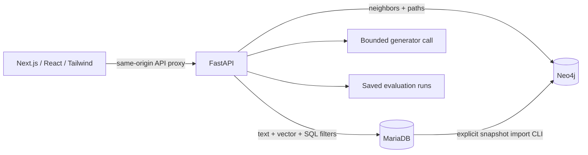

# CiteHop architecture decisions

Status: implementation specification for the course project. The user selected Next.js, React, Tailwind CSS, FastAPI, and Neo4j. MariaDB remains necessary for the supplied native-vector-search assignment. These choices replace the former Streamlit plan.

## Stack review

| Layer | Decision | Why / cost |
|---|---|---|
| Frontend | Next.js App Router + React + TypeScript | One frontend with routable Search, Library, Graph, Dashboard views. No second Node business API. |
| Styling | Tailwind CSS, shared tokens, small reusable component set | Reuses the established navy/cyan identity; consistent responsive design without a large UI framework. |
| Graph rendering | React Flow custom nodes with a deterministic radial layout | Rich clickable article/category cards, bounded interactive exploration. No always-running force simulation or 3D rendering. |
| Charts | Recharts with table alternatives | Two small dashboard comparisons; no analytics platform. Pin at implementation. |
| API | FastAPI + Pydantic schemas | Python retrieval/model ecosystem and a single typed HTTP contract. |
| Corpus/vector store | MariaDB with native VECTOR index and FULLTEXT | Canonical text, metadata, embeddings, SQL filtering/joins, and measured course demonstration. |
| Graph store | Neo4j Community with official Python driver | Real graph traversal for neighborhood/path exploration; adds a local service and explicit snapshot import. |
| Evaluation | Python CLI and saved JSON/CSV | Reproducible runs without a jobs service or metrics database. |

React is part of Next.js here, not a separate application. Neo4j holds no duplicate embeddings and does not serve vector search. Graph-assisted retrieval is optional; a polished graph explorer is core.

## Runtime and ownership

FastAPI owns all application data operations. Next.js provides rendering/navigation and a thin same-origin `/api/*` proxy; do not duplicate Python logic in Next route handlers. Use the Node server URL for upstream configuration, never expose database or model credentials in `NEXT_PUBLIC_*`. Use an explicit API base configuration for server rendering, because relative browser URLs do not work in server code. Keep one API client/schema contract across both contexts.

Use server-rendered layout where useful and client components for search state, charts, and graph interaction. React Flow loads only for the Graph view. Source content renders as escaped text/safe Markdown; model output must not inject raw HTML.

Use synchronous FastAPI handlers or explicit thread offloading for blocking MariaDB/Neo4j/model code. Keep one cached embedder per API process and one development API worker to avoid duplicate model memory. Bound concurrent inference to one active generation, with a clear busy response; no automatic retries on generation. UI abort/stale-response handling prevents old results replacing new ones but must not claim a provider call was cancelled unless it was. No queue, Redis, streaming requirement, or orchestration framework.

## Local topology and dependencies

- `frontend/`: App Router pages, shared components, Tailwind tokens, generated API types, graph layout.
- `citehop/api/`: FastAPI application, request/response schemas, thin routes.
- `citehop/`: database, ingestion, embeddings, retrieval, RAG, graph adapter, evaluation.
- `docker/`: Compose for MariaDB and Neo4j, persistent isolated volumes and health checks.
- `sql/`, `eval/`, `results/`, `docs/`: schema, reviewed questions, run evidence, documentation.

Run frontend and API on the host for development; run both databases in Compose. Proposed ports: frontend 3000, API 8000, MariaDB 3306, Neo4j Bolt 7687 and browser 7474, bound to localhost. Document overrides for conflicts. Store `DB_*`, `NEO4J_URI/USER/PASSWORD`, API upstream, and chosen model settings in examples without real secrets. Health checks distinguish API availability from individual service readiness. No request should start ingestion or reset a database.

C01 selects compatible supported package releases using official documentation, pins database images and lockfiles, and records requirements. Do not invent a current Next.js/Neo4j version in a planning document. Keep CPU smoke runs small and measure total memory/runtime before the full demo; Neo4j and embeddings add memory costs.

## Graph snapshot contract

MariaDB owns the articles, normalized categories, and directed article-link records. Neo4j imports this state with stable IDs:

- `Article`: article ID, title, source URL, revision ID.
- `Category`: canonical category ID/name.
- `(:Article)-[:LINKS_TO]->(:Article)`: a real outgoing link in the pinned article snapshot.
- `(:Article)-[:IN_CATEGORY]->(:Category)`: category membership from that snapshot.

No inferred concepts, authors, similarity edges, or fabricated relationships. Retrieval scores are UI annotations scoped to a query, not permanent graph facts.

C04 chooses a consistent import strategy: a versioned staging snapshot with activation after validation, or a small explicit rebuild with `rebuilding` status. Do not present partial imports as current. Use uniqueness constraints and parameterized batch writes. Cleanup is confined to CiteHop-managed nodes; never clear an arbitrary Neo4j database. Reconcile removals as well as additions.

Expose `status` (`ready`, `stale`, `rebuilding`, `unavailable`), source corpus version, imported version, and import timestamp. Neo4j transactions do not make changes atomic with MariaDB. On version mismatch, disable expansion/path operations and offer reimport guidance; retain normal SQL search. Raw graph inspection can be labeled stale but must not be mixed into current search evidence.

## Graph query limits

Neighborhood: one hop by default, maximum two; default 50 nodes/100 edges, hard caps 100/200. Include article/category filters, stable ordering, `truncated`, source seed, and graph version. Return edges only when both endpoints are included. Enforce bounds in backend Cypher/query construction, not merely in the renderer. Limit intermediate expansion and apply a short configurable transaction timeout; output LIMIT alone does not bound traversal work.

Expansion adds a selected node's neighborhood while respecting the total visible cap. Preserve current node positions. Keep article-link and category traversal separately selectable; category hubs do not silently expand to the entire corpus.

Path: two article IDs, maximum three `LINKS_TO` hops, deterministic shortest path among that bounded search, timeout. Offer directed mode by default; if an undirected exploration mode is provided, label it and retain original edge arrows. No path means “No path within 3 links,” not “These articles are unrelated.” Categories are excluded from this path mode to avoid meaningless hub shortcuts.

## HTTP contract owned by C09

All routes are under `/api/v1`; document actual schemas in generated OpenAPI.

| Route | Responsibility |
|---|---|
| `GET /health` | API and per-service status, without credentials. |
| `POST /search` | Query, method, filters, k → hits, effective filters, corpus/config version, timings. |
| `POST /answer` | Question, selected chunk IDs, corpus version → bounded answer, citation map, status, usage/timing. Server fetches passages; reject stale/missing IDs. |
| `GET /articles` | Title/category filter, bounded page/page size → articles and total. |
| `GET /articles/{id}` | Source metadata, bounded/paginated passages, category info. |
| `GET /graph/status` | Snapshot state/version/counts. |
| `GET /graph/neighborhood` | Seed, bounded hops/limits/types → nodes, edges, truncation/version metadata. |
| `GET /graph/path` | Article IDs and allowed direction mode → bounded path and scope. |
| `GET /stats` | Corpus counts and embedding coverage; graph stats labeled separately. |
| `GET /runs` and `GET /runs/{id}` | Saved compatible manifests/results, explicit split and review state. |
| `GET /runs/{id}/export` | Selected run CSV with fixed columns; no arbitrary filesystem paths. |

Keep request/response types in FastAPI and derive frontend types from OpenAPI. Avoid maintaining two handwritten contracts. Make error responses safe and useful; distinguish invalid input, missing data, service unavailable, and busy inference. No generic query endpoint or client-supplied Cypher/SQL. Validate IDs and export paths.

## References used in the review

- [Next.js server/client components](https://nextjs.org/docs/app/getting-started/server-and-client-components): keep interactive components at client boundaries.
- [FastAPI concurrency](https://fastapi.tiangolo.com/async/): blocking libraries require synchronous handlers or suitable offloading.
- [Neo4j Python transactions](https://neo4j.com/docs/python-manual/current/transactions/): transactional graph operations; not a cross-database consistency guarantee.
- [React Flow custom nodes](https://reactflow.dev/learn/customization/custom-nodes) and [layout guidance](https://reactflow.dev/learn/layouting/layouting): custom visual nodes and controlled layout computation.

The specific service split, limits, layout, and import strategy above are design decisions for this project, not vendor requirements.
