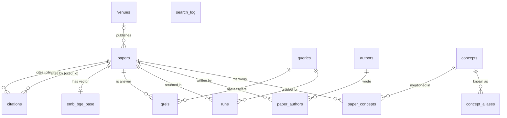

# CiteHop data model (MariaDB)

The target schema is in two files. Both are safe to rerun.

| File | Make target | Contents |
|---|---|---|
| [`sql/schema.sql`](../sql/schema.sql) | `make schema` | 6 core tables (card #8) and `search_log` (card #34) |
| [`sql/kg_schema.sql`](../sql/kg_schema.sql) | `make kg-schema` | 6 knowledge graph tables, `papers.venue_id` and the `kg_links` view (card #12.5). Run after `make schema` |

The core tables are copied from `CITEHOP_BOOTSTRAP.md` 4.9 and 4.10. `search_log` is not in the bootstrap. M2 added it for handoff row D9.

The old Wikipedia tables live in the same database. See [Legacy (until M8)](#legacy-until-m8).

## Diagram



## Rules this schema follows

- No vector index in either file (rule 10). M3 adds the cosine index on `emb_bge_base.emb` after the bulk load (card #15). Card #15.5 does the same for `concepts.emb`. `tests/test_schema.py` checks that neither table has one.
- No other index is added to a table after its vector index exists. So every B-tree and FULLTEXT index on `emb_bge_base` and `concepts` must be in the schema files.
- Every foreign key points at `papers`, `queries`, `authors`, `venues` or `concepts`. MariaDB creates a B-tree index for each foreign key column that has none. Those indexes are listed below as "implicit".
- Tables with text use `DEFAULT CHARSET=utf8mb4`. On 11.8.9 that resolves to `utf8mb4_uca1400_ai_ci` (case and accent insensitive).

## Core tables (`sql/schema.sql`)

### `papers`
One row per LitSearch paper.

| Column | Type | Notes |
|---|---|---|
| `corpusid` | `BIGINT` PK | LitSearch corpus id |
| `title` | `TEXT NOT NULL` | |
| `abstract` | `TEXT` | |
| `year` | `SMALLINT NULL` | filled from LitSearch or Semantic Scholar (card #12.7) |
| `n_cited_by` | `INT NOT NULL DEFAULT 0` | in-corpus citation count, filled after `citations` loads (card #10) |
| `venue_id` | `INT NULL` | added by `kg_schema.sql` |

| Index | Columns | Why |
|---|---|---|
| `PRIMARY` | `corpusid` | joins from every other table |
| `ft_title_abstract` | FULLTEXT (`title`, `abstract`) | keyword search with `MATCH ... AGAINST` (card #16) |
| `fk_paper_venue` (implicit) | `venue_id` | foreign key to `venues`; venue lookups in `kg_links` |

### `citations`
The citation graph. One row per in-corpus citation.

| Index | Columns | Why |
|---|---|---|
| `PRIMARY` | (`citing_id`, `cited_id`) | outgoing references of a paper; rejects duplicate edges |
| `k_cited` | (`cited_id`, `citing_id`) | incoming citations, so the recursive CTE can walk both directions (card #22) |

Both columns are foreign keys to `papers`.

### `emb_bge_base`
One 768-dim `BAAI/bge-base-en-v1.5` vector per paper. One table per embedding model, so a second model gets its own `emb_<model>` table.

| Column | Type | Notes |
|---|---|---|
| `corpusid` | `BIGINT` PK, FK to `papers` | |
| `emb` | `VECTOR(768) NOT NULL` | `NOT NULL` because a vector index requires it |

| Index | Columns | Why |
|---|---|---|
| `PRIMARY` | `corpusid` | joins back to `papers` |
| `vx_emb` (added in M3, not in the schema) | VECTOR (`emb`) `DISTANCE=cosine` | meaning search (card #17) |

### `queries`
The 597 LitSearch questions.

| Column | Type | Notes |
|---|---|---|
| `query_id` | `INT` PK | |
| `text` | `TEXT NOT NULL` | |
| `kind` | `ENUM('specific','broad')` | specific: Recall@5. broad: Recall@20 |
| `origin` | `ENUM('inline','author')` | how LitSearch built the question |
| `split` | `ENUM('dev','test')` | stratified 20/80, seed 42 (card #12). Never tune on `test` |

### `qrels`
The answer key: which papers answer which question.

| Index | Columns | Why |
|---|---|---|
| `PRIMARY` | (`query_id`, `corpusid`) | answers per question; grading joins on it |
| `fk_qrels_p` (implicit) | `corpusid` | foreign key to `papers` |

### `runs`
Every graded result. One row per (config, question, rank).

| Column | Type | Notes |
|---|---|---|
| `config` | `VARCHAR(8)` | `A` to `L`, plus `P` for the prototype search |
| `query_id`, `rnk` | `INT`, `SMALLINT` | |
| `corpusid` | `BIGINT` | the returned paper |
| `score` | `DOUBLE` | final score of the config |
| `found_via` | `SET('kw','vec','cite','concept','author')` | every path that found the paper |

| Index | Columns | Why |
|---|---|---|
| `PRIMARY` | (`config`, `query_id`, `rnk`) | a config's ranked list per question |
| `fk_runs_q`, `fk_runs_p` (implicit) | `query_id`; `corpusid` | foreign keys |

### `search_log`
Production observability (card #34). Stores a hash of the query, never the raw text.

| Column | Type | Notes |
|---|---|---|
| `log_id` | `BIGINT AUTO_INCREMENT` PK | |
| `ts` | `TIMESTAMP(3)` | default now, millisecond precision |
| `query_hash` | `BINARY(32)` | 32-byte digest of the normalised query. Card #34 picks the hash (a keyed HMAC is safer than plain SHA-256 against guessing) |
| `config` | `VARCHAR(8)` | which config served the request |
| `n_results` | `SMALLINT` | |
| `latency_ms` | `INT` | |

| Index | Columns | Why |
|---|---|---|
| `PRIMARY` | `log_id` | append-only inserts |
| `k_ts` | `ts` | time-window queries and pruning old rows |

## Knowledge graph tables (`sql/kg_schema.sql`)

### `authors` and `paper_authors`
Authors from Semantic Scholar (card #12.7). `paper_authors.position` is the author order.

| Table | Index | Columns | Why |
|---|---|---|---|
| `authors` | `PRIMARY` | `author_id` | |
| `paper_authors` | `PRIMARY` | (`corpusid`, `author_id`) | authors of a paper |
| `paper_authors` | `k_author` | (`author_id`, `corpusid`) | papers of an author (config L, card #23.6) |

### `venues`
| Index | Columns | Why |
|---|---|---|
| `PRIMARY` | `venue_id` (auto-increment) | |
| `name` | `name` UNIQUE | one row per venue name; lets the loader use `INSERT IGNORE` |

`kg_schema.sql` also adds `papers.venue_id` with `ADD COLUMN IF NOT EXISTS` and the foreign key `fk_paper_venue` with `FOREIGN KEY IF NOT EXISTS`. MariaDB 11.8.9 accepts both, and a second run adds nothing (`tests/test_schema.py`).

### `concepts`, `concept_aliases`, `paper_concepts`
LLM-extracted concepts (cards #13.5 to #15.5).

| Table | Column or index | Why |
|---|---|---|
| `concepts` | `kind ENUM('method','task','dataset','metric')`, `df` (papers per concept), `emb VECTOR(768) NOT NULL` | `df` gives the IDF weight in config K. `emb` is for concept merging |
| `concepts` | `uq_kind_name` UNIQUE (`kind`, `name`) | one row per concept; `INSERT IGNORE` is safe |
| `concept_aliases` | `PRIMARY` (`alias`), `fk_alias_concept` (implicit) | map a surface form to one concept |
| `paper_concepts` | `PRIMARY` (`corpusid`, `concept_id`, `relation`) | concepts of a paper |
| `paper_concepts` | `k_concept` (`concept_id`, `corpusid`) | papers of a concept (config K, card #23.5) |
| `paper_concepts` | `evidence TEXT NOT NULL`, `confidence` | the quote from the abstract that supports the link |

The vector index on `concepts.emb` is added after loading (card #15.5), never in the schema.

## View `kg_links (a, b, rel)`

Every link in both directions, as typed string ids: `paper:<corpusid>`, `author:<id>`, `concept:<id>`, `venue:<id>`.

| `rel` | From | To |
|---|---|---|
| `cites` / `cited_by` | paper | paper |
| `wrote` / `written_by` | author / paper | paper / author |
| `proposes`, `uses`, `evaluates_on`, `addresses` | paper and concept, both directions | |
| `published_in` | paper and venue, both directions | |

Use `kg_links` for exploring: the Graph Explorer and ad hoc 2-hop walks. Use the typed tables for search and grading. They use their own indexes, while `kg_links` builds strings and cannot use an index on `a` or `b`.

## Load order

Foreign keys fix the order:

1. `papers` (card #10)
2. `citations`, then update `papers.n_cited_by` (card #10)
3. `emb_bge_base`, then add the cosine vector index (cards #14, #15)
4. `queries`, then `qrels` (card #12)
5. `venues`, `authors`, `paper_authors`, then `papers.venue_id` (card #12.7)
6. `concepts`, `concept_aliases`, `paper_concepts`, then the `concepts.emb` index (cards #13.5 to #15.5)
7. `runs` (card #19), `search_log` (card #34)

## Legacy (until M8)

These are the Wikipedia prototype tables. They stay loaded and unchanged until M8, so the prototype UI keeps working. MariaDB is the source of truth for that corpus. Neo4j (C04) is derived from these tables. Schema: [`sql/corpus_schema.sql`](../sql/corpus_schema.sql). Loader: [`citehop/corpus.py`](../citehop/corpus.py).

### Tables

| Table | Key | Contents |
|---|---|---|
| `articles` | `article_id INT UNSIGNED` (Wikipedia page ID) | Title (unique), pinned `revision_id BIGINT UNSIGNED`, UTC revision timestamp, source/revision URLs, extracted `text MEDIUMTEXT`, `text_sha256`, `length_chars`, `is_smoke`, license URL, attribution line. |
| `article_categories` | (`article_id`, `category_name VARCHAR(255)`) | Category membership as returned by Wikipedia. The canonical category ID is the exact name. |
| `article_links` | (`source_article_id`, `target_article_id`) | Directed internal link between two corpus articles. |
| `chunks` | `chunk_id CHAR(64)` (ASCII, deterministic ID assigned by C05) | Passage of one article revision: `chunk_config`, `ordinal`, character span, `token_count`, `text`, `embedding VECTOR(768) NOT NULL`, `embedding_config`. |
| `embedding_configs` | `embedding_config CHAR(64)` | C05: JSON settings behind each `chunk_config`/`embedding_config` hash. See [EMBEDDINGS.md](EMBEDDINGS.md). |
| `corpus_versions` | `version_id INT UNSIGNED` (auto-increment) | One row per distinct loaded content: content SHA-256, C02 `corpus_id`, subset, counts, timestamp. The current version is the highest `version_id`. |

Titles and category names use `utf8mb4_bin`. The server default collation is accent- and case-insensitive, so it would merge distinct Wikipedia names (for example `Machine Learning` and `Machine learning`). Text columns use the default collation so FULLTEXT search ignores case.

### Constraints and indexes

- Foreign keys from categories, links, and chunks to `articles` all use `ON DELETE CASCADE`. Links have both endpoints constrained, so orphan edges cannot exist. A `CHECK` rejects self-links, and the composite primary keys reject duplicate edges and duplicate memberships.
- `chunks (article_id, revision_id)` references `articles (article_id, revision_id)` with `ON UPDATE RESTRICT`. The database therefore refuses to change a revision while chunks of the old revision exist, and it refuses chunks for a revision that is not current.
- Search indexes: `FULLTEXT ft_chunks_text (text)` and `VECTOR INDEX vx_chunks_embedding (embedding) M=16 DISTANCE=cosine`. MariaDB 11.8.9 accepts both and keeps them (`SHOW CREATE TABLE`). `EXPLAIN` of `ORDER BY VEC_DISTANCE_COSINE(...) LIMIT k` uses `vx_chunks_embedding` (`tests/test_corpus_db.py`). `M=16` is above the server default of 6: a larger graph costs little at this corpus size and improves ANN recall. C08 measures recall against the exact baseline.
- Metadata indexes: `articles.length_chars` for length filters, `article_categories (category_name, article_id)` for category filters, `article_links (target_article_id, source_article_id)` for reverse lookups (the primary key already serves linked-from), and `chunks (chunk_config, embedding_config)` for coverage and stale-configuration checks.

Embeddings live on the chunk row because a vector index requires a `NOT NULL` column. C05 inserts each chunk together with its vector. Embedding coverage is therefore the share of articles that have chunks for the active configuration.

### Loading and versioning

```bash
python -m citehop.acquire fetch --subset smoke --offline       # C02: data/wikipedia/smoke.json
python -m citehop.apply_sql sql/corpus_schema.sql              # C01 runner; safe to rerun
python -m citehop.corpus --snapshot data/wikipedia/smoke.json  # or data/wikipedia/full.json
```

The loader checks every record against `eval/corpus.json`: the corpus ID, the pinned revision, the text hash and length, and unique IDs and titles. It accepts only the complete smoke subset or the complete full subset. Links are resolved by exact title within the snapshot. Titles outside the snapshot (other Wikipedia pages, or redirects that were not resolved) are counted as `orphan_links` and are not stored. Duplicate categories and self-links are counted and dropped.

One transaction reconciles the database to the snapshot:

1. Delete chunks of changed revisions and removed articles.
2. Delete obsolete links and categories, then the removed articles.
3. Give renamed articles a temporary title, update changed articles by ID, and insert new ones, in batches of 25 because article text is large. A title can therefore move between page IDs without overwriting another row. Then insert new categories and links in batches of 500.
4. Append a `corpus_versions` row if the content hash differs from the latest row.

Loading the smoke snapshot after the full one removes the other 90 articles. An identical rerun writes nothing, and the version stays the same. Any error rolls back the whole load. Embedding configuration changes are handled by C05 through `chunk_config` and `embedding_config`, not by this version table ([EMBEDDINGS.md](EMBEDDINGS.md)).

### Measured counts (pinned C02 snapshot `deb00bb7…`, MariaDB 11.8.9, 2026-10-31)

| Subset | Version | Articles | Category rows | Distinct categories | Links | Orphan link titles dropped | Chunks |
|---|---|---|---|---|---|---|---|
| smoke | 1 | 10 | 169 | 119 | 39 | 1,680 | 269 |
| full | 2 | 100 | 1,101 | 456 | 917 | 7,587 | 1,776 |

Chunk counts are for the 300/50 configuration from C05. Each subset was loaded twice. The second run had identical counts, wrote nothing, and kept the version. Article text totals 2,175,082 characters (3,630–70,128 per article). Each load took about 0.3 s wall time on the development Mac.

Known limitation: the stored categories include Wikipedia's hidden maintenance categories (for example `Articles with short description` on all 100 articles). The raw parse output marks them `hidden`, but the C02 record format drops that flag. They should not become graph hubs or filter options until C02 keeps the flag.
