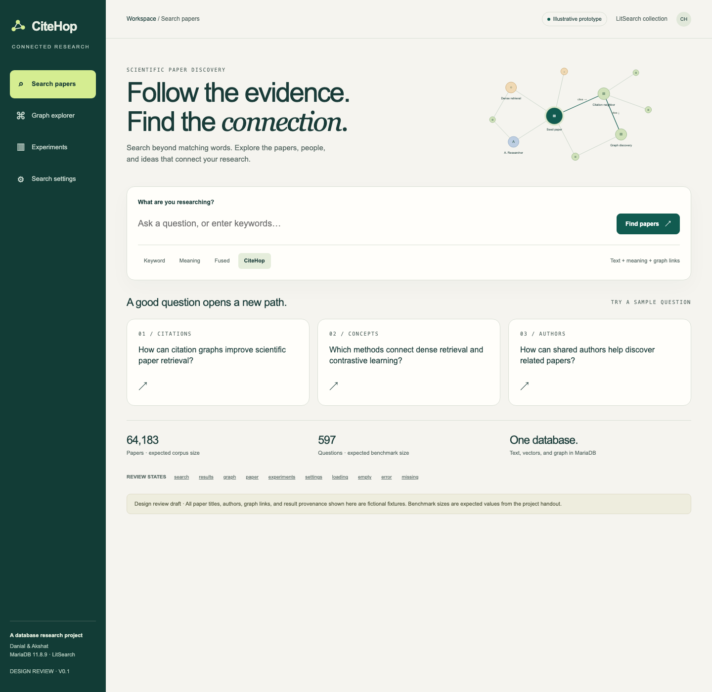
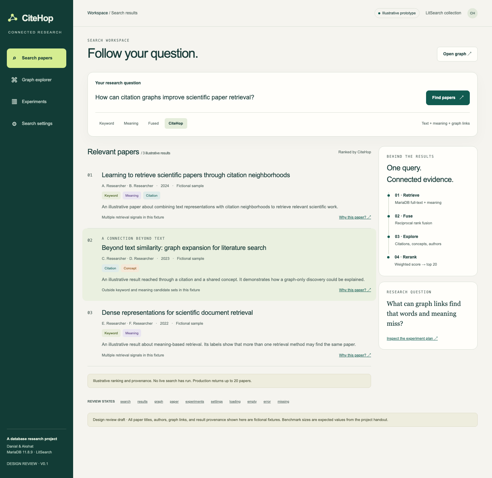
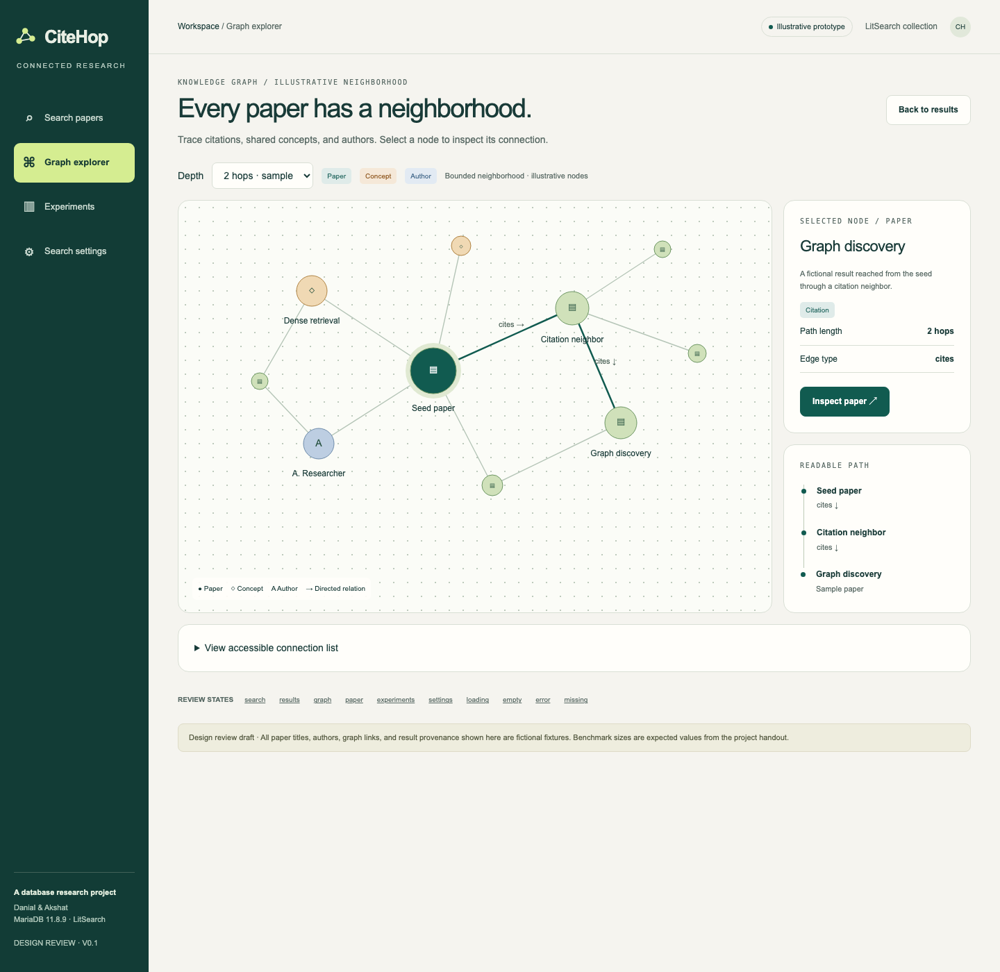
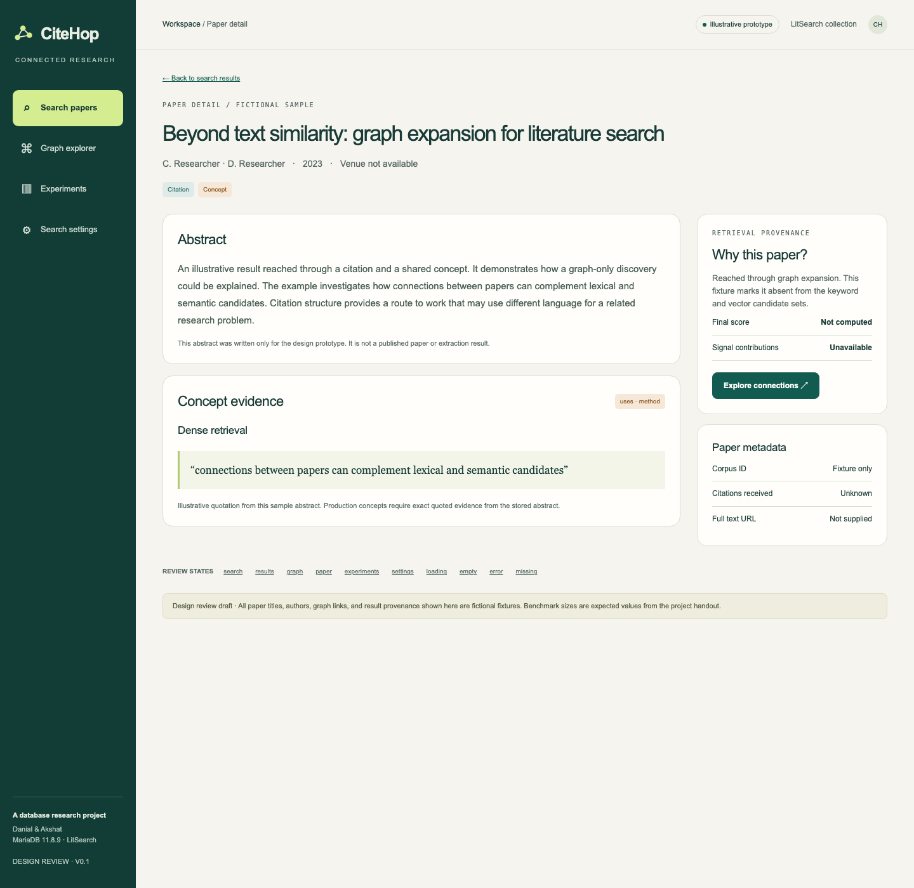
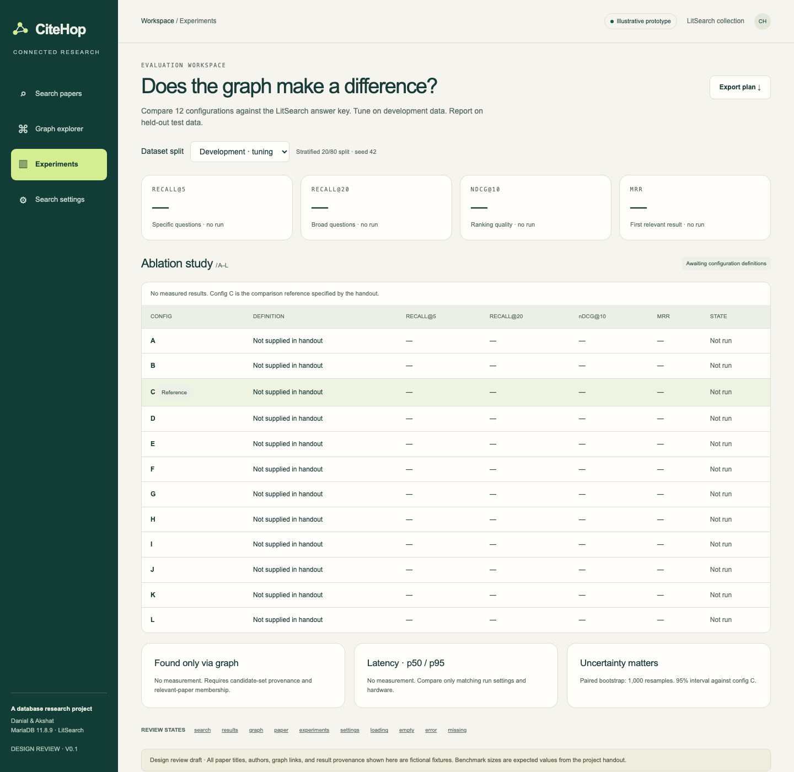
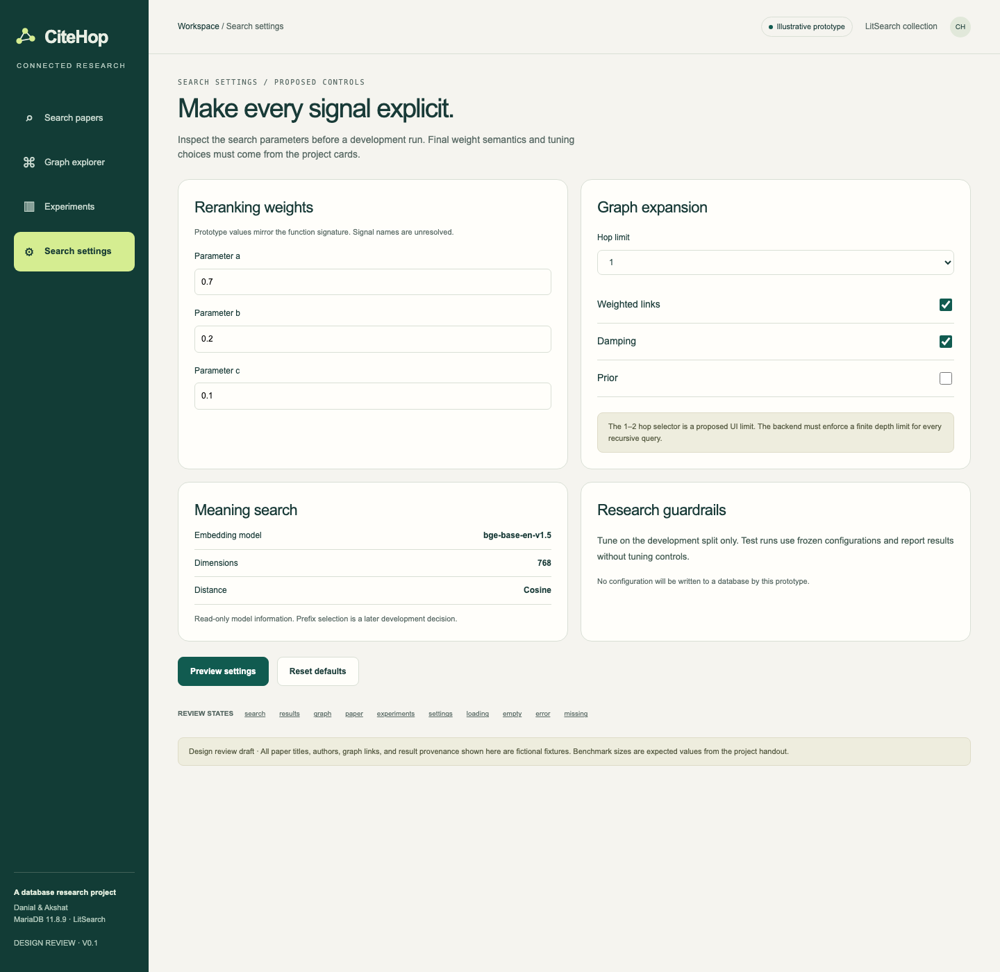
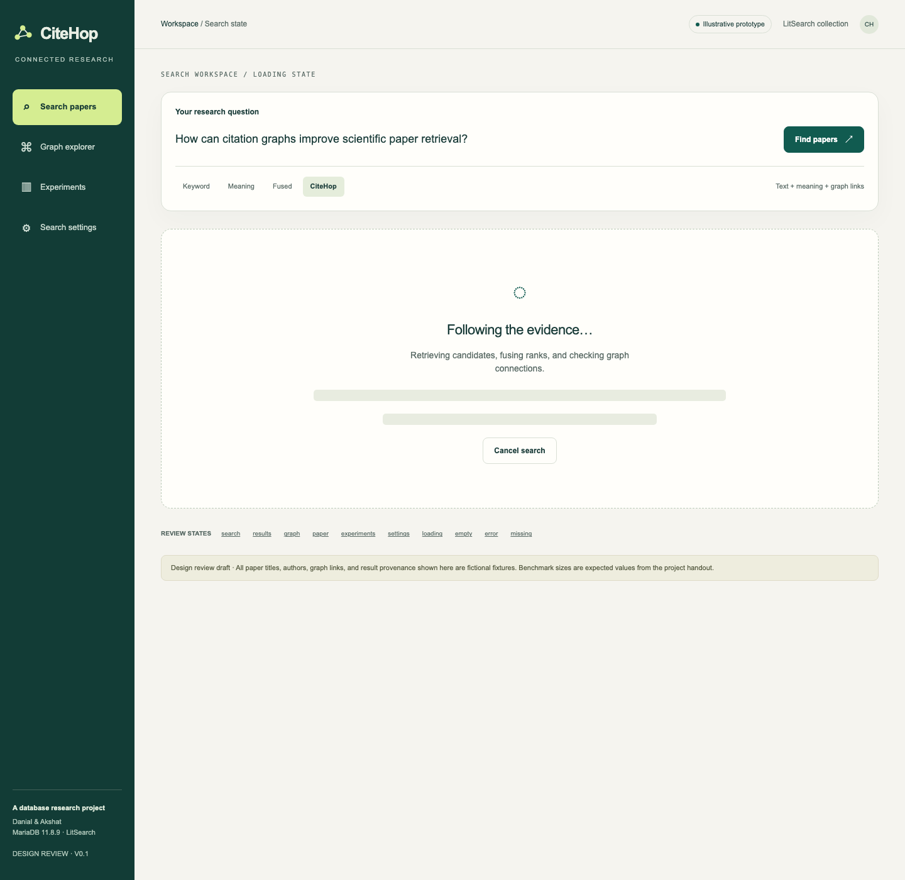
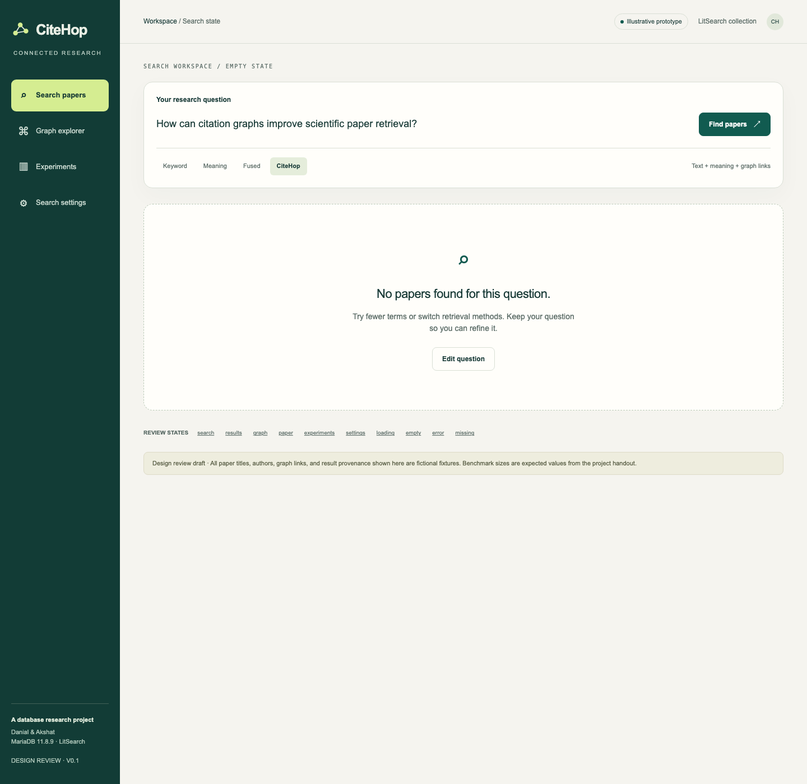
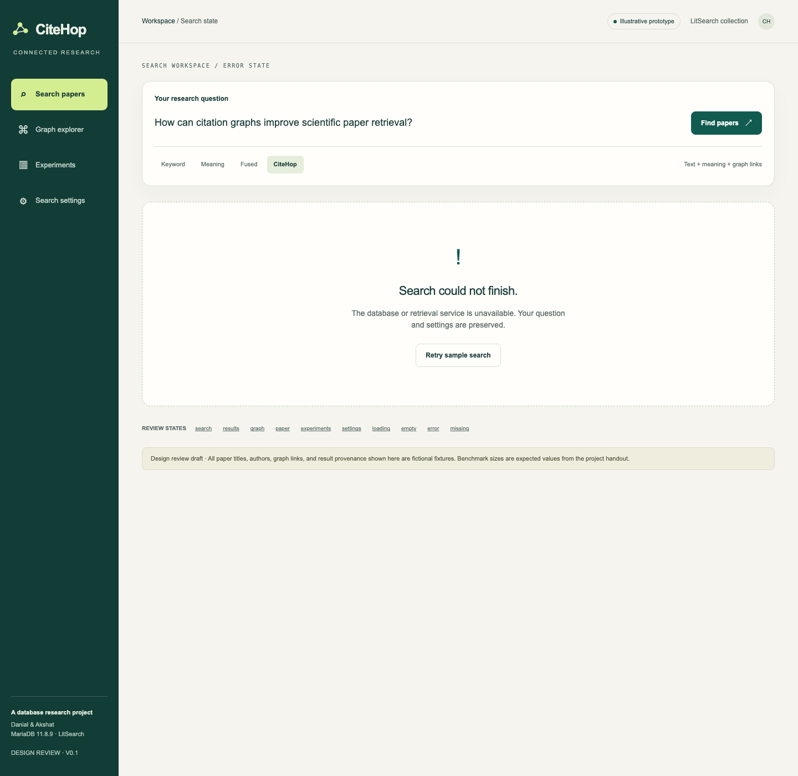
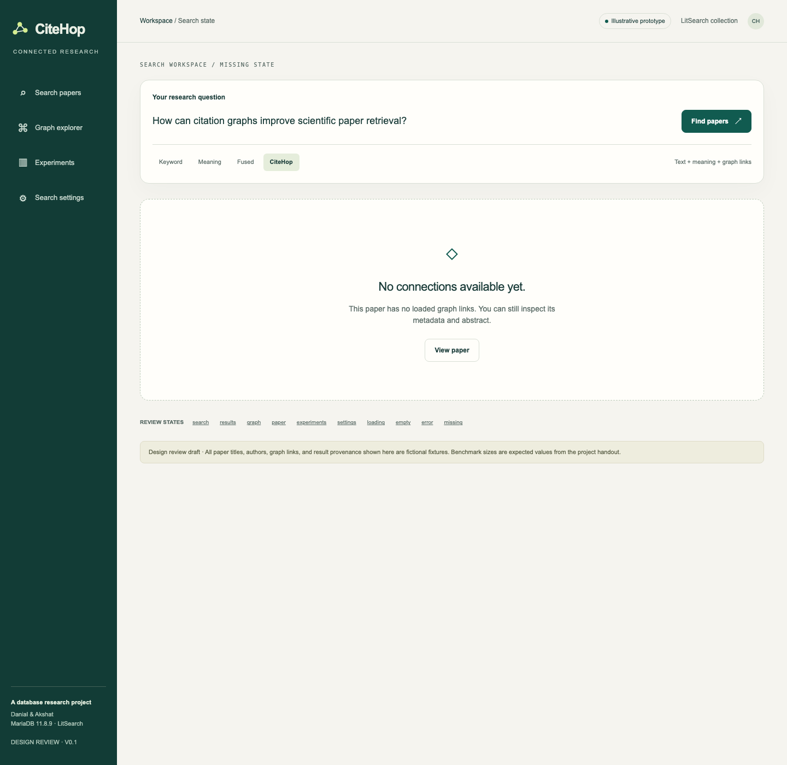

# CiteHop design

> [!WARNING]
> **Superseded.** This is the v0.1 light sketch. The approved design is handoff 1.0 in [`/design`](../../design/README.md). Do not implement from this folder.

This folder holds the UI design for the CiteHop demo app (card #28) and the graph explorer (card #28.5).
Everything here is a sketch. Paper titles, authors, graph links and scores in it are fictional fixtures.

## Files

| File | What it is |
|---|---|
| [AGENT_INSTRUCTIONS.md](AGENT_INSTRUCTIONS.md) | **Start here if you are an agent.** Rules, read order, workflow and done checklist for UI work. |
| [SCREENS.md](SCREENS.md) | Every screen and state: layout, content, behaviour, and which table or function feeds each element. |
| [DESIGN_SYSTEM.md](DESIGN_SYSTEM.md) | Colours (light and dark), type, spacing, components, accessibility. |
| [citehop-preview-v0.1.html](citehop-preview-v0.1.html) | Clickable prototype, light theme. One self-contained file. The source of truth for content, behaviour and states. |
| [desktop-search-dark.png](desktop-search-dark.png) | Dark theme mockup of the search screen. The newer visual direction. |
| [screens/](screens/) | PNG renders of every prototype route at 1440 px, plus one at 390 px (mobile). |

## View the prototype

```bash
open docs/design/citehop-preview-v0.1.html          # macOS
xdg-open docs/design/citehop-preview-v0.1.html      # Linux
```

Use the **Review states** links at the bottom of each page to jump between routes.
Routes are hash based: `#search`, `#results`, `#graph`, `#paper-1`, `#experiments`, `#settings`, `#loading`, `#empty`, `#error`, `#missing`.

## Screen gallery

| Route | Render |
|---|---|
| `#search` (light) |  |
| `#search` (dark) |  |
| `#results` |  |
| `#graph` |  |
| `#paper-1` |  |
| `#experiments` |  |
| `#settings` |  |
| `#loading` |  |
| `#empty` |  |
| `#error` |  |
| `#missing` |  |
| `#search` at 390 px |  |

## Regenerate the renders

```bash
C="/Applications/Google Chrome.app/Contents/MacOS/Google Chrome"
F="$PWD/docs/design/citehop-preview-v0.1.html"
for r in search results graph paper-1 experiments settings loading empty error missing; do
  "$C" --headless=new --hide-scrollbars --window-size=1440,1400 --virtual-time-budget=2000 \
    --screenshot="$PWD/docs/design/screens/light-$r.png" "file://$F#$r"
done
"$C" --headless=new --hide-scrollbars --window-size=390,1500 --virtual-time-budget=2000 \
  --screenshot="$PWD/docs/design/screens/light-search-mobile.png" "file://$F#search"
```
